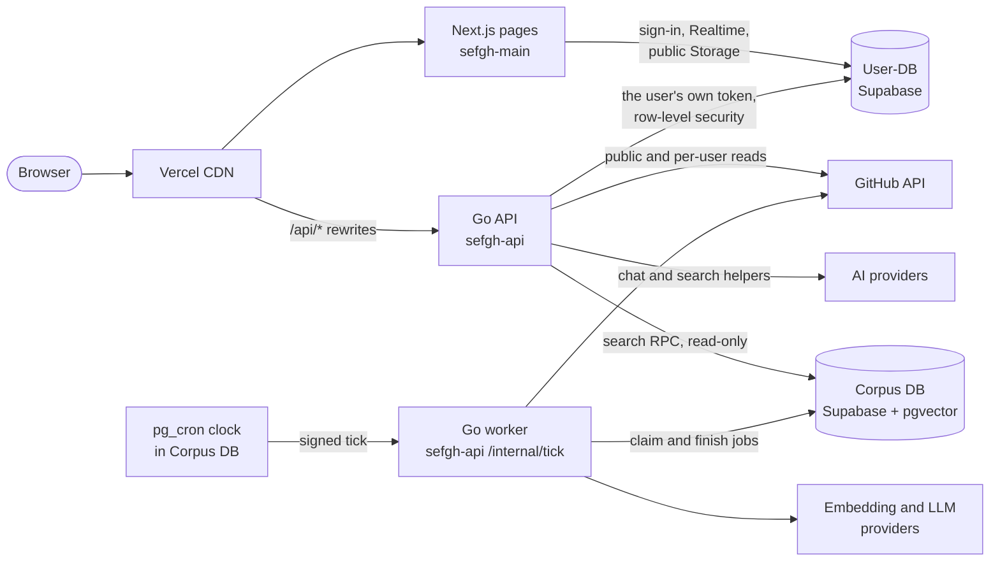
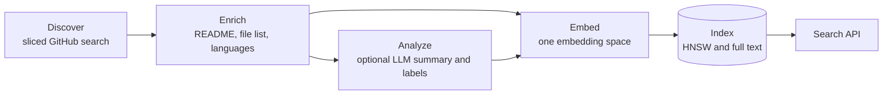
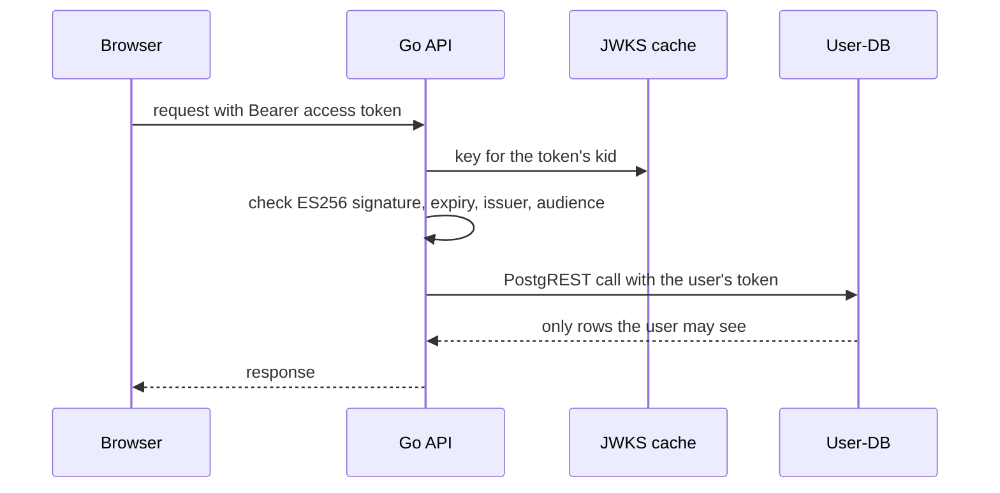
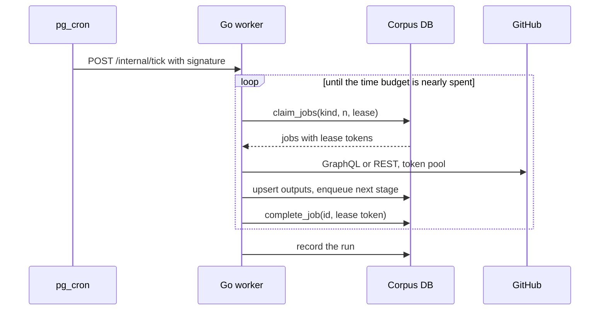
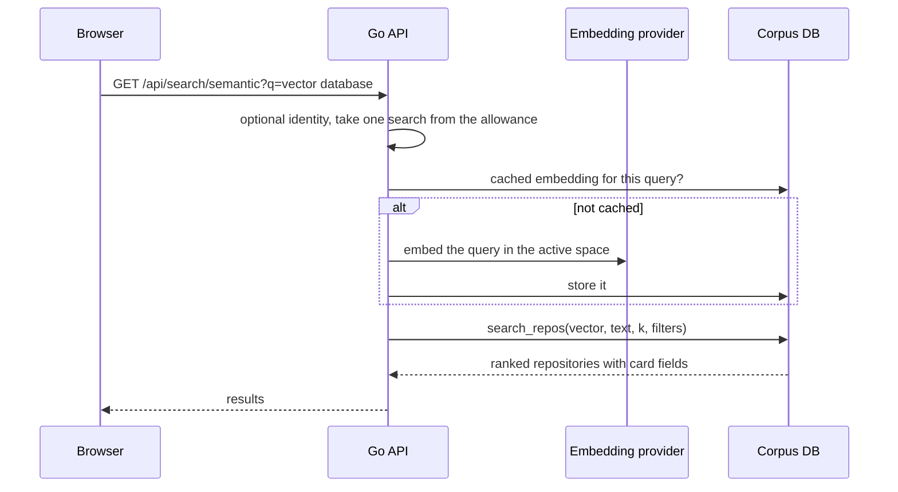

# SEFGH backend: high-level design

**Status: proposal** (ARCH-001, Claude Code, 2026-10-24). Nothing here is decided until the owner answers decisions D1 to D8 (section 11). It covers everything behind the UI. [`adr/0002-go-backend.md`](../adr/0002-go-backend.md) says *how* each route moves to Go; this document describes *what the whole backend should look like* when the moves are done, including the data pipeline the ADR's Phases 4 and 5 left open. The detailed design is in [`lld.md`](lld.md).

Facts below were checked on 2026-10-24 unless marked as an estimate. Estimates are there to size choices, not to promise performance; each one has to be measured (ADR, "Measurements").

## 1. Where things stand

| Area | Today | Problem |
|---|---|---|
| Website API | 23 of 25 Next.js routes ported to Go, off by default except trending; cutover step 1 ready ([cutover.md](../cutover.md)) | Two implementations of every route until Phase 7 |
| Identity | Every signed-in request asks Supabase Auth over the network (`githubaccess.Verifier`) | A round trip per request, Washington to Mumbai; R-042 |
| Limits | AI allowances counted in each server copy's memory | Looser than intended; spoofable client address (R-038) |
| Regions | Both Vercel projects run functions in `iad1` (Washington); both Supabase projects are in Mumbai | Every database call crosses that distance (not yet measured) |
| Browser data | Many areas call Supabase directly; a Go data proxy exists for all of them, off by default | Business rules live in two places |
| Ingestion | RepoSync (Python) runs on a PC, writes `repositories` | Crashes when keys run out (R-190), strands topics (R-191), marks partial work complete (R-193, R-194); 10 recorded defects in all |
| Analysis | Three Python analysers (Gemini; Ollama `gemma3`; legacy) read `ReposMeta` | Not connected to RepoSync's table; two incompatible embedding models in one corpus (R-116); stale embeddings (R-119); `npx repomix@latest` downloads and runs an unpinned package for every repository; batch state in local files |
| Semantic search | A FastAPI service, service-role key, no sign-in or quota; nothing calls it | The website's search is GitHub's keyword search |
| Repo-DB | Paused: Supabase pauses free projects after a week without activity | Its contents are unverified |

Verdict on RepoSync and the RepoAnalysers: good experiments, not a system. The useful ideas are worth keeping (section 13). What is missing is one pipeline with durable state, one embedding model, separated credentials and a place to run it.

## 2. Goals, constraints and non-goals

**Goals**

1. One backend behind the UI: Go for every API route and for the pipeline, Next.js for pages only.
2. One pipeline from GitHub to search, whose state lives in the database, so any run can stop and the next one continues.
3. Least privilege: no component holds more access than its job needs; the website's API never holds a service-role key.
4. Free tier first, with clear points where paying would change the design.
5. Everything checkable: contract fixtures for behaviour, a frozen corpus for search quality, rollback per route and per stage.

**Constraints** (checked 2026-10-24)

- Go standard library only (ADR); Supabase Auth, database, Storage and Realtime stay.
- Vercel Hobby: cron jobs at most **once a day**; a function invocation is bounded in time (300 s by default).
- Supabase Free: **500 MB** database, **2 active projects**, projects **paused after a week** without activity. User-DB has pgvector **0.8.0** installed; `pg_cron`, `pg_net`, `pgmq` and `pg_trgm` are available but not installed.
- This repository is private: GitHub Actions has **2,000 free minutes a month**, shared with CI.
- GitHub: GraphQL allows 5,000 points an hour per token; a search returns at most **1,000** results.

**Non-goals:** the UI; replacing Supabase; splitting into many services for its own sake. "Microservice" here means a separately deployed, separately credentialed unit, and there are only three: the API, the worker, and the databases.

## 3. The whole system

Three planes:

- **Request plane:** the Go API answers the website, quickly and statelessly. It never does bulk work.
- **Data plane:** User-DB holds people's data; the Corpus DB holds public data derived from GitHub. They are separate because their credentials, size and lifetime are different.
- **Pipeline plane:** a Go worker does the slow work in small, resumable steps, driven by a job table in the Corpus DB.

## 4. Building blocks

### 4.1 Go API (request plane)

One Go service on Vercel, the destination of the website's `/api/*` rewrites. Every request passes the same chain: request id, panic recovery, security headers, method and body limits, a deadline, identity, a limit check, then the route's handler. Upstream calls carry the request's deadline, a per-call timeout and a reply size cap, and never follow redirects with credentials.

It calls User-DB as the user, with the user's own token, so the database's row-level security always applies. It holds only the public key for User-DB, never a service-role key. That rule already holds in the ported routes and stays.

Identity becomes a local check (D6). User-DB publishes one ES256 key at `/auth/v1/.well-known/jwks.json`, so the API can verify a token's signature, expiry, issuer and audience itself, with `crypto/ecdsa` from the standard library, and cache the key. Supabase Auth is still asked directly where a stolen-but-unexpired token would matter (account and key management). Confirm with a real access token that its `kid` matches the published key before relying on this.

### 4.2 User-DB

People's data: profiles, conversations, comments, votes, collections, notifications, activity, shares, keys. Row-level security stays as the second line of defence. Business writes move behind the Go API (the data proxy already covers every area, off by default). The browser keeps only what Supabase does best directly: sign-in, Realtime subscriptions and public Storage links.

Limits that must be exact (AI allowances) move from memory into a small table with an atomic function that spends only the caller's own allowance (D8). Anonymous limits keyed by address stay in memory until the API has a narrow server credential (LLD 2.3).

### 4.3 Corpus DB

Public data about GitHub repositories: the catalog, star history, fetched documents, analyses, embeddings, and the pipeline's own job table. It is rebuildable from GitHub at any time, which is why it can live apart from people's data and have a cheaper backup story.

It should be its own Supabase project (D1). The worker then holds that project's service key, and a leaked worker key can never touch people's data. The API reaches it with that project's public key, allowed to call one read-only search function and nothing else.

### 4.4 Pipeline (worker plane)

Each stage reads jobs of its kind from the job table, does a bounded piece of work, writes its output, and adds a job for the next stage. A job is held under a lease: if a worker dies, the lease expires and another run picks the job up. Outputs are written with upserts keyed by the repository and a hash of the input, so running a job twice is harmless. A stage only redoes work when its input actually changed.

**Discover** replaces RepoSync. It splits a search by creation date (and by stars when needed) until each slice has at most 1,000 results, and keeps each slice's cursor in the database, so a restart continues mid-topic. It records a daily star count per repository, which also gives the site a real "stars gained this week" for trending.

**Enrich** replaces cloning. It reads the README through GitHub's API (which finds `README.md`, `readme.rst` and the rest) and the top-level file list and languages through GraphQL. No `git clone`, no `npx`, nothing downloaded and run.

**Analyze** is optional (D4). The first version can skip it and embed a well-built document instead. An LLM summary is added only if the search evaluation shows it helps.

**Embed** uses exactly one embedding space at a time: one provider, model, revision, dimension and document recipe, recorded in a table. Query embeddings must come from the same space. A new model means a new table filled in the background, then a switch. Two models can never be mixed in one index, which is what R-116 does today.

### 4.5 Search

A new Go route, off by default, does semantic search: optional identity, a limit check, the query's embedding (cached), and one call to a read-only database function. That function fuses vector similarity with Postgres full-text ranking (reciprocal-rank fusion) and returns repository cards. Before the UI uses it, quality is measured on a frozen corpus with labelled queries, using the offline checker that already exists ([`searchparity`](../../backend/internal/searchparity/parity.go)).

### 4.6 Scheduler (D2)

The Corpus DB's `pg_cron` calls the worker's endpoint every few minutes through `pg_net`, with a signed header. Each call claims a few jobs, works for a fixed time budget below the function limit, and returns. The clock lives in the database, but every bit of work stays in Go. The ADR's earlier objection to `pg_cron` + `pg_net` was to doing the work in SQL, which this does not.

The same worker runs as a command line too (`--once`), so the owner can run a stage locally, for example an LLM stage on a machine with a GPU. The job table coordinates all runs, wherever they happen.

## 5. Key flows

**A signed-in request**

**One pipeline tick**

**A semantic search**

## 6. Who owns which data

| Data | Store | Written by | Read by |
|---|---|---|---|
| Accounts, sessions | Supabase Auth (User-DB) | Supabase Auth | API (verify), browser (sign-in) |
| Profiles, conversations, comments, votes, collections, notifications, activity, shares | User-DB, row-level security | API as the user (browser directly until each area switches) | API as the user; Realtime for conversations |
| Avatars | User-DB Storage, public bucket | API as the user | Anyone, by public link |
| Playground keys | User-DB, private schema | API through dedicated functions | API; accountant role (gated) |
| Repository catalog, star history, documents, analyses, embeddings | Corpus DB | Worker (service key of that project only) | API through `search_repos`; the worker |
| Pipeline jobs and runs | Corpus DB | Worker | Worker; owner through SQL or a later admin page |

## 7. Security

| Component | Credentials it holds | Can never |
|---|---|---|
| Browser | The user's session | Read another user's rows (row-level security) |
| Go API | User-DB public key; Corpus DB public key (search function only); GitHub public-read token; AI keys; the tick secret | Bypass row-level security; write the corpus |
| Go worker | Corpus DB service key; GitHub tokens; embedding and LLM keys; the tick secret | Touch User-DB |
| `pg_cron` | The tick secret, kept in Supabase Vault | Do anything but call the tick endpoint |

Supply chain: standard library only in Go; no `npx`/`latest` anywhere in the pipeline; CI pins actions by commit (already true). Logging: no tokens, keys, cookies, emails or document text in logs (already the rule for ported routes).

## 8. Reliability

- **At-least-once jobs, made safe:** leases with a token per claim, so a stalled worker's late result is refused; upserts keyed by input hashes; a unique key per job, so repeated enqueues collapse.
- **Failures are classified, not counted:** rate limits wait until the reset time GitHub gives; temporary errors back off with jitter; permanent errors stop a job after a few attempts and park it for review.
- **Nothing partial is "complete":** a discovery slice is complete only when its cursor reaches the end; a repository's stage is current only when the stored input hash equals the latest input.
- **Budgets:** each tick has a time budget; GitHub points, embedding calls and LLM tokens have daily caps in a small usage table.

## 9. Performance and capacity (estimates to measure)

- **Region:** both Vercel projects run functions in Washington; both databases are in Mumbai. Moving the Go API's functions to `bom1` (Mumbai) should cut database round trips but lengthen GitHub calls. Measure both before choosing (D7).
- **Corpus size:** about 1 KB catalog row, 4 KB README excerpt, 1 KB analysis and 1.5 KB for a 768-dimension `halfvec`, plus index overhead, roughly 8 to 10 KB a repository. A 500 MB free database then holds a few tens of thousands of repositories, not millions. Scope (D5) has to fit that, or the plan changes.
- **GitHub:** a search page of 100 repositories usually costs a point or two of the 5,000 an hour; the new queries ask for `cost`, so this becomes measured rather than assumed (R-192).
- **Search latency:** one embedding call plus one database function. Cached query embeddings and CDN caching of anonymous results keep repeated queries cheap.

## 10. Observability

- Every request and every tick gets an id in structured logs (`log/slog`).
- One `job_runs` row per tick: stage, claimed, done, failed, GitHub points, provider calls, duration. It replaces RepoSync's four monitoring tables and session snapshots.
- A stuck job is visible as an expired lease; a failing stage as rising `failed` counts. A small admin page can read these later; SQL is enough at first.

## 11. Decisions for the owner

**Accepted by the owner on 2026-10-28: every recommendation below** (ADR-0002 decisions log). RepoSync is wanted and is to be rebuilt better inside this plan.

| # | Decision | Options | Recommendation |
|---|---|---|---|
| D1 | Where the corpus lives | **A** its own Supabase project; **B** a `corpus` schema in User-DB; **C** restore Repo-DB as is | **A**, reusing the paused Repo-DB project after a read of what it holds. The free plan allows 2 active projects, so the development project would stay paused when not in use, or a paid plan is needed |
| D2 | What drives the pipeline | **A** `pg_cron` ticks to the Go worker on Vercel; **B** a GitHub Actions schedule (uses the 2,000 private minutes CI also needs); **C** the owner's PC; **D** a paid always-on host | **A**, with C for anything that needs a local GPU |
| D3 | The embedding space | One provider, model and dimension, chosen by a small labelled evaluation | A hosted model at 768 dimensions stored as `halfvec`; no GPU needed |
| D4 | LLM summaries | **A** a hosted model; **B** local Ollama run by hand; **C** none in version 1 | **C** first; add A or B only if the evaluation shows better results |
| D5 | Corpus scope and freshness | Which topics or languages, minimum stars, refresh cadence | Start small (a few topics, a stars floor), refresh stars daily for the top and weekly for the rest; grow within 500 MB |
| D6 | Verifying identity | **A** local ES256 check from Supabase's published key, online check only for sensitive actions; **B** keep the online check everywhere | **A** |
| D7 | Function region | Keep `iad1`, or move the Go API to `bom1` next to the databases | Measure, then decide |
| D8 | Exact AI limits (R-038) | **A** a database counter per user; **B** keep per-copy memory | **A** for signed-in users; in memory for signed-out callers until a server credential exists |

## 12. Migration path

Each step is separate, reviewed and reversible. They fit the ADR's phases rather than replacing them.

1. **Decide** D1 to D8.
2. **Request plane** (Phases 1 to 3 cutover, as running now): switch steps from [cutover.md](../cutover.md); add the local identity check behind a setting (D6); measure regions (D7); database limits (D8).
3. **Corpus foundation** (Phase 4): read Repo-DB, then a reviewed migration for the corpus schema, job table and functions; the tick endpoint, off by default; the Discover stage built from the RepoSync port. R-189 to R-198 are fixed when the Go worker replaces the Python one, which is RepoSync's cutover.
4. **Enrich and Embed** (Phase 5) on a small scope; the search function; the Go search route, off by default; evaluation on a frozen corpus.
5. **UI** uses semantic search behind a flag (UI work, outside this document).
6. **Analyze**, only if step 4's evaluation justifies it.
7. **Retire** (Phase 7): the Python services, `ReposMeta` and other unused tables, the Next.js handlers, and the old routes, each after the ADR's Phase 6 gate and the owner's approval.

## 13. What to keep from today's services

- RepoSync: key rotation, GraphQL search by topic, the topic queue idea, and its recorded contract as the starting point for Discover.
- RepoAnalyser (Google variant): the document recipe (summary, labels, README, file structure, joined and capped). It becomes "document version 1", with its Python-character cap kept exact.
- RepoAnalyser-ai: the quality scoring and prompts, if D4 brings LLM summaries back; its parallel batch idea, which becomes bounded concurrency inside a tick.
- The offline search checker (`searchparity`) and its frozen-run format, for every model or recipe change.
