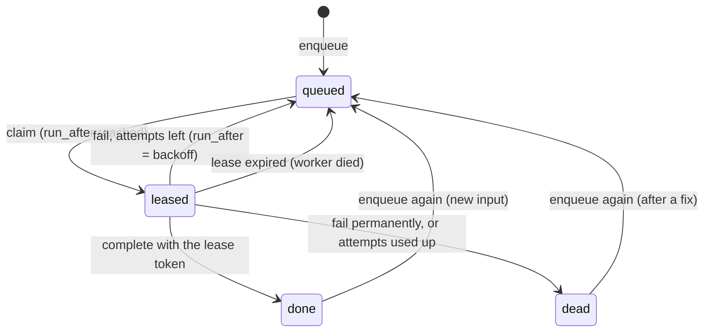

# SEFGH backend: low-level design

**Owner update 2026-11-01:** corpus schema is now planned inside User-DB.
The separate-project/service-role passages and grants below are historical
sketches, not applicable deployment instructions. A corpus-only worker role,
reviewed PUBLIC/inherited grants and verified user-data denial are required.
See [consolidation plan](../plans/database-consolidation.md); do not apply this
document's SQL or copy a project-wide key into the worker.

**Status: proposal** (ARCH-001, Claude Code, 2026-10-24), detailing [`hld.md`](hld.md). SQL and Go below are sketches to review, not migrations or code to apply: every database change still goes through a reviewed migration, verify query and rollback, run only with the owner's approval. Decision numbers D1 to D8 are in the HLD, section 11.

## 1. Go module layout

One module, standard library only. Existing packages stay; new ones are marked.

```text
backend/
  cmd/api/                 HTTP server: route table, middleware, settings (exists)
  cmd/worker/              NEW tick handler and CLI: --once, --stage, --budget
  cmd/reposync/            exists; folds into cmd/worker's discover stage at RepoSync's cutover
  cmd/searchparity/        exists: offline search comparison
  internal/<route>/        one package per API route (activity, avatar, collect, ... exist)
  internal/supabaserest/   exists: PostgREST calls as the user
  internal/githubaccess/   exists: online identity check (Supabase, then GitHub)
  internal/identity/       NEW local ES256 verifier behind the same function type
  internal/limits/         NEW database allowance for signed-in users; replaces ailimit's memory (D8)
  internal/corpus/         NEW PostgREST client for the Corpus DB: repos, documents, embeddings, jobs
  internal/jobs/           NEW enqueue/claim/complete/fail protocol, tick runtime, budgets
  internal/github/         NEW GraphQL and REST client, token pool, rate-limit classes, search slicing
  internal/pipeline/       NEW discover, enrich, analyze, embed stages
  internal/search/         NEW document recipe, query cache, semantic search handler
  internal/searchparity/   exists: frozen-run comparison
```

Rule kept from the ADR: no third-party Go module unless the standard library cannot reasonably do the job, and the reason goes in the ADR. Nothing below needs one.

## 2. Request plane

### 2.1 Middleware chain

| Order | Step | Notes |
|---|---|---|
| 1 | Request id | From `x-vercel-id` when present, else random; put on the context and every log line |
| 2 | Recover | A panic becomes a 500 with no detail, logged with the request id |
| 3 | Security headers | As today (`X-Frame-Options`, CSP, `X-Sefgh-Backend: go`) |
| 4 | Method and body limits | Per route, as today (`http.MaxBytesReader`) |
| 5 | Deadline | Per route budget with `context.WithTimeout`, plus the connection read deadline for uploads |
| 6 | Identity | 2.2; only for routes that need it |
| 7 | Allowance | 2.3; only for routes that spend something (AI, search) |
| 8 | Handler | The route package |

Upstream calls (already the rule in ported routes): the request's context, a per-call timeout (10 s default), a reply cap (8 MiB default), no redirects for requests carrying credentials, and no raw error text in logs.

### 2.2 Identity (D6)

Route packages receive identity as a function, `func(*http.Request) (id, session string, status int)`, which `cmd/api` takes from `githubaccess.Verifier` today. The local verifier implements the same function, so no route changes. A setting chooses: `SEFGH_IDENTITY=online` (today) or `jwks`.

```go
// Package identity verifies Supabase access tokens locally.
type Verifier struct {
	SupabaseURL string        // issuer is SupabaseURL + "/auth/v1"
	HTTP        *http.Client  // for the key list only
	Now         func() time.Time
	// cached keys by kid, guarded by a mutex; refreshed at most once a minute
}

func (v *Verifier) User(r *http.Request) (id, session string, status int)
```

Steps for `User`:

1. Take the bearer token as `githubaccess.SessionToken` does today; none means 401.
2. Split it into three base64url parts. Header must be JSON with `alg` exactly `ES256` and a non-empty `kid`. Every other algorithm is refused, `none` and `HS256` included, which closes algorithm confusion.
3. Look up `kid` in the cache. If it is missing and the last refresh was more than a minute ago, fetch `GET {SupabaseURL}/auth/v1/.well-known/jwks.json` (5 s timeout, 64 KiB cap). Keep only keys with `kty` `EC`, `crv` `P-256`, `alg` `ES256`; build `*ecdsa.PublicKey` from `x` and `y`. Refresh in any case when the cache is older than ten minutes.
4. The signature is 64 bytes, `r` then `s`. Check it with `ecdsa.Verify(key, sha256(header + "." + payload), r, s)`; `crypto/ecdsa`, `crypto/sha256` and `math/big` are all standard library.
5. Claims: `exp` after now (30 s leeway); `iat` not more than 60 s ahead; `iss` equals the issuer; `aud` is or contains `authenticated`; `role` is `authenticated`; `sub` is a UUID. The app never signs anyone in anonymously, so `is_anonymous: true` is refused.
6. Return `sub` as the id and the token as the session, so calls to User-DB still go as the user.

What stays online:

- Routes that also check the user's linked GitHub account (AUTH-001) keep that GitHub check. Only the Supabase half becomes local.
- A token stays valid until it expires even after sign-out (one hour by default in Supabase). Sensitive actions keep the online check: playground key management, account changes. A `Strict` wrapper uses `githubaccess.Verifier`.

Failure: no cached key and the key list unreachable gives 503 `{"error":"Sign-in check unavailable"}`, not 401, so an outage is not shown as "signed out". That changes the contracts' identity cases, so it goes through the contract process with R-063, which is the same question today. Before switching, confirm with one real access token that its header `kid` is the published key's.

**Checked 2026-10-24** (a standard-library proof of concept, not committed): User-DB's published key parses as a P-256 point with `crypto/ecdsa` and `crypto/elliptic`; an ES256 token signed in the test in this exact format verifies, and the same token with an altered payload is refused. **Not checked:** a real User-DB access token's `kid` against the published key.

### 2.3 Allowances (D8, R-038)

Signed-in users: a table and one function in User-DB. The function takes the user from `auth.uid()`, so a caller can only spend their own allowance. A caller-supplied key would let one user drain another's.

```sql
create table private.allowance_rules (
  bucket     text primary key,             -- 'ai-chat', 'search'
  capacity   real not null,                -- e.g. 30
  per_second real not null                 -- e.g. 30 / 300 for 30 per five minutes
);
create table private.allowances (
  user_id    uuid not null,
  bucket     text not null references private.allowance_rules,
  tokens     real not null,
  updated_at timestamptz not null default now(),
  primary key (user_id, bucket)
);

create function public.take_allowance(p_bucket text) returns boolean
language plpgsql security definer set search_path = '' as $$
declare
  v_user uuid := auth.uid();
  v_rule private.allowance_rules;
  v_left real;
begin
  if v_user is null then return false; end if;
  select * into v_rule from private.allowance_rules where bucket = p_bucket;
  if not found then return false; end if;
  insert into private.allowances as a (user_id, bucket, tokens)
  values (v_user, p_bucket, v_rule.capacity - 1)
  on conflict (user_id, bucket) do update
    set tokens = least(v_rule.capacity,
                       a.tokens + extract(epoch from now() - a.updated_at)::real * v_rule.per_second) - 1,
        updated_at = now()
  returning tokens into v_left;
  if v_left < 0 then          -- refused: give the token back
    update private.allowances set tokens = tokens + 1
     where user_id = v_user and bucket = p_bucket;
    return false;
  end if;
  return true;
end $$;
revoke all on function public.take_allowance(text) from public, anon;
grant execute on function public.take_allowance(text) to authenticated;
```

The upsert locks the user's row, so concurrent requests from one user are counted exactly. This is a token bucket (bursts up to the capacity, then a steady rate), not today's per-copy counter, so it is a contract change for the AI routes. Signed-out callers stay on the in-memory counter keyed by the address Vercel sets, until the API has a narrow server credential of its own.

### 2.4 Caching

| Reply | Cache |
|---|---|
| Public GitHub reads | CDN `s-maxage` as each contract pins today |
| Anything read with a user's credential | `no-store` |
| Semantic search, signed out | `public, s-maxage=300`; the query string is the cache key |
| Semantic search, signed in | `no-store` (it spends the user's allowance) |

In-process caches (the repository summary cache) stay as optimisations only; nothing relies on them being shared between copies.

## 3. Corpus DB schema (D1)

All tables live in a schema `corpus` in the Corpus DB project. That schema is exposed to the Data API so the worker can use PostgREST, but `anon` gets no table privileges and every table has row-level security with no policies, which denies all. The worker uses that project's service role (D1 keeps it away from User-DB). `anon` may only execute `corpus.search_repos`.

```sql
create schema corpus;
create extension if not exists vector with schema extensions;  -- User-DB has it in public

create table corpus.repos (
  github_id        bigint primary key,                 -- GitHub databaseId
  node_id          text not null unique,               -- GraphQL id; survives renames
  full_name        text not null,                      -- current owner/name
  owner_login      text not null,
  owner_type       text,
  description      text,
  homepage         text,
  primary_language text,
  license          text,
  topics           text[] not null default '{}',
  is_fork          boolean not null default false,
  is_archived      boolean not null default false,
  stars            integer not null default 0,
  forks            integer not null default 0,
  created_at       timestamptz,
  pushed_at        timestamptz,
  first_seen_at    timestamptz not null default now(),
  synced_at        timestamptz not null default now(),
  status           text not null default 'active' check (status in ('active', 'gone')),
  search_text      text,                               -- written by the worker
  search           tsvector generated always as (to_tsvector('simple', coalesce(search_text, ''))) stored
);
create index on corpus.repos (lower(full_name));
create index on corpus.repos (stars desc);
create index on corpus.repos using gin (topics);
create index on corpus.repos using gin (search);

create table corpus.repo_names (                       -- rename history
  github_id bigint not null references corpus.repos on delete cascade,
  full_name text not null,
  seen_at   timestamptz not null default now(),
  primary key (github_id, full_name)
);

create table corpus.repo_daily (                       -- one row per repository per day
  github_id bigint not null references corpus.repos on delete cascade,
  day       date not null,
  stars     integer not null,
  forks     integer not null,
  primary key (github_id, day)
);

create table corpus.discovery_slices (
  id           bigint generated always as identity primary key,
  query        text not null,                          -- e.g. 'topic:rust'
  created_from date not null,
  created_to   date not null,
  stars_min    integer,
  stars_max    integer,
  total        integer,                                -- GitHub's repositoryCount for the slice
  cursor       text,                                   -- resume point inside the slice
  fetched      integer not null default 0,
  state        text not null default 'open' check (state in ('open', 'split', 'complete')),
  completed_at timestamptz,
  unique nulls not distinct (query, created_from, created_to, stars_min, stars_max)
);

create table corpus.documents (
  github_id      bigint primary key references corpus.repos on delete cascade,
  readme_excerpt text,                                 -- Markdown stripped, capped
  readme_etag    text,                                 -- for conditional requests
  tree_top       text[] not null default '{}',         -- top-level names
  languages      jsonb not null default '{}',          -- {"Go": 1234}
  source_hash    text not null,                        -- hash of everything above
  fetched_at     timestamptz not null default now()
);

create table corpus.analyses (                         -- only if D4 brings LLM summaries
  github_id        bigint not null references corpus.repos on delete cascade,
  analysis_version text not null,                      -- prompt hash and model id
  input_hash       text not null,                      -- documents.source_hash it was made from
  summary          text not null,
  labels           text[] not null default '{}',
  created_at       timestamptz not null default now(),
  primary key (github_id, analysis_version)
);

create table corpus.embedding_spaces (
  id               smallint primary key,
  provider         text not null,
  model            text not null,
  model_revision   text,
  dimension        smallint not null,
  document_version text not null,                      -- recipe, 7.4
  query_prefix     text,
  document_prefix  text,
  normalized       boolean not null,
  state            text not null default 'building' check (state in ('building', 'active', 'retired')),
  created_at       timestamptz not null default now()
);

-- One table per space keeps each HNSW index whole and its queries simple.
create table corpus.embeddings_v1 (
  github_id  bigint primary key references corpus.repos on delete cascade,
  input_hash text not null,                            -- hash of the exact document embedded
  vec        extensions.halfvec(768) not null,
  created_at timestamptz not null default now()
);
create index on corpus.embeddings_v1 using hnsw (vec extensions.halfvec_cosine_ops);

create table corpus.query_cache (
  space_id   smallint not null references corpus.embedding_spaces,
  query_norm text not null,                            -- lower case, single spaces
  vec        extensions.halfvec(768) not null,
  hits       integer not null default 1,
  created_at timestamptz not null default now(),
  primary key (space_id, query_norm)
);

create table corpus.jobs (                             -- section 4
  id           bigint generated always as identity primary key,
  kind         text not null check (kind in ('discover', 'refresh', 'enrich', 'analyze', 'embed')),
  key          text not null,                          -- idempotency key: slice id, github_id
  payload      jsonb not null default '{}',
  state        text not null default 'queued' check (state in ('queued', 'leased', 'done', 'dead')),
  attempts     integer not null default 0,
  max_attempts integer not null default 6,
  run_after    timestamptz not null default now(),
  lease_token  uuid,
  lease_until  timestamptz,
  rerun        boolean not null default false,         -- re-enqueued while leased
  last_error   text,
  created_at   timestamptz not null default now(),
  updated_at   timestamptz not null default now(),
  unique (kind, key)
);
create index on corpus.jobs (kind, run_after) where state = 'queued';
create index on corpus.jobs (lease_until) where state = 'leased';

create table corpus.job_runs (
  id          bigint generated always as identity primary key,
  trigger     text not null,                           -- 'cron', 'cli'
  started_at  timestamptz not null,
  finished_at timestamptz,
  stages      jsonb not null default '{}',             -- {"discover": {"claimed": 3, "done": 3, "failed": 0}}
  gh_points   integer not null default 0,
  provider_calls integer not null default 0,
  note        text
);

create table corpus.usage_daily (                      -- caps for paid or limited providers
  day      date not null,
  provider text not null,                              -- 'github', 'embeddings', 'llm'
  units    bigint not null default 0,                  -- points, tokens or calls
  primary key (day, provider)
);

alter table corpus.repos enable row level security;    -- and the same for every table above
grant usage on schema corpus to anon;
grant execute on function corpus.search_repos to anon;  -- section 8.1; nothing else
```

Size estimate per repository (to measure): catalog 1 KB, README excerpt up to 4 KB, analysis 1 KB, `halfvec(768)` 1.5 KB plus HNSW overhead. That is roughly 8 to 10 KB, so a few tens of thousands of repositories fit in 500 MB.

## 4. Job protocol



```sql
-- Add or refresh a job. A job enqueued while leased is marked to run again.
create function corpus.enqueue(p_kind text, p_key text, p_payload jsonb, p_run_after timestamptz default now())
returns void language sql as $$
  insert into corpus.jobs as j (kind, key, payload, run_after)
  values (p_kind, p_key, p_payload, p_run_after)
  on conflict (kind, key) do update set
    payload    = excluded.payload,
    run_after  = least(j.run_after, excluded.run_after),
    rerun      = j.rerun or j.state = 'leased',
    state      = case when j.state in ('done', 'dead') then 'queued' else j.state end,
    attempts   = case when j.state in ('done', 'dead') then 0 else j.attempts end,
    updated_at = now();
$$;

-- Lease up to p_limit ready jobs of one kind. Expired leases come back,
-- which is what RepoSync lacks (R-191).
create function corpus.claim_jobs(p_kind text, p_limit integer, p_lease_seconds integer)
returns setof corpus.jobs language sql as $$
  with ready as (
    select id from corpus.jobs
     where kind = p_kind and attempts < max_attempts
       and ((state = 'queued' and run_after <= now())
         or (state = 'leased' and lease_until < now()))
     order by run_after, id
     limit p_limit
     for update skip locked
  )
  update corpus.jobs j set
    state = 'leased', lease_token = gen_random_uuid(),
    lease_until = now() + make_interval(secs => p_lease_seconds),
    attempts = j.attempts + 1, updated_at = now()
  from ready where j.id = ready.id
  returning j.*;
$$;

-- Finish a job. Only the current lease holder may: a late worker whose lease
-- expired gets null back and must drop its result.
create function corpus.complete_job(p_id bigint, p_token uuid) returns text language sql as $$
  update corpus.jobs set
    state = case when rerun then 'queued' else 'done' end,
    rerun = false, run_after = now(), lease_token = null, lease_until = null,
    last_error = null, updated_at = now()
  where id = p_id and lease_token = p_token and state = 'leased'
  returning state;
$$;

create function corpus.fail_job(p_id bigint, p_token uuid, p_error text,
                                p_retry_after_seconds integer, p_permanent boolean)
returns text language sql as $$
  update corpus.jobs set
    state = case when p_permanent or attempts >= max_attempts then 'dead' else 'queued' end,
    run_after = now() + make_interval(secs => p_retry_after_seconds),
    last_error = left(p_error, 500), lease_token = null, lease_until = null, updated_at = now()
  where id = p_id and lease_token = p_token and state = 'leased'
  returning state;
$$;
```

Retry delay, computed in Go: `min(6h, 30s × 2^(attempts−1)) × (0.5 + random[0, 0.5))`, unless the failure carries its own time (a rate-limit reset or `Retry-After`), which wins. A rate-limit wait is never "sleeping inside a tick": the job is put back with `run_after` set to the reset time. That is how waiting fits a serverless function, and it removes RepoSync's crash path (R-190).

**Checked 2026-10-24:** every SQL block in this document (sections 2.3, 3, 4 and 8.1; not the `pg_cron` call) ran on PGlite 0.2.17 with pgvector 0.8.0, the version User-DB has, in a scratch script that is not committed. 23 of 23 checks passed: repeated enqueues collapse into one job; a leased job is not handed out twice; a wrong or stale lease token cannot complete a job; an enqueue during a run requeues it afterwards; backoff is respected; an expired lease is claimed again with a new token; a permanent failure is dead; hybrid search ranks the nearest repository first, falls back to full text without a vector and applies the stars filter; allowances allow exactly the capacity, are separate per user and do not spend on refusal. The first run found that the DDL relied on Supabase's migration search path for `halfvec`; the types are now schema-qualified. **Not checked:** two workers claiming at the same moment (`for update skip locked`), which needs a real Postgres with two connections.

## 5. Worker runtime

### 5.1 The tick

`POST /internal/tick` on the Go API project:

1. Check `Authorization: Bearer <tick secret>` with `subtle.ConstantTimeCompare`; anything else is 404, so the route is not advertised. A replay only starts another tick, which the leases make harmless.
2. Detach from the client: `ctx := context.WithoutCancel(r.Context())` with its own deadline of `budget` (setting, for example 240 s, below the function limit). `pg_net` may give up waiting before the work is done; the work continues to its budget. If the platform stops the function anyway, leases expire and the jobs return.
3. Run the stages in order (refresh, discover, enrich, analyze, embed). Each gets a share of the remaining budget and a batch size. The stage list is a setting, so a stage can be switched off.
4. Write one `job_runs` row, then answer 200 with the counts.

`pg_cron` in the Corpus DB:

```sql
select cron.schedule('pipeline-tick', '*/10 * * * *', $$
  select net.http_post(
    url     := 'https://sefgh-api.vercel.app/internal/tick',
    headers := jsonb_build_object(
      'Authorization', 'Bearer ' || (select decrypted_secret from vault.decrypted_secrets where name = 'tick_secret'),
      'Content-Type', 'application/json'),
    body    := '{}'::jsonb,
    timeout_milliseconds := 300000)
$$);
```

The interval is chosen after measuring Vercel usage over the first week. Check `pg_net`'s timeout limits when implementing. `cmd/worker --once --stage enrich --budget 10m` runs the same code from a terminal, for example an LLM stage on a machine with a GPU (D4 B).

### 5.2 Stages in Go

```go
type Job struct {
	ID       int64
	Kind     string
	Key      string
	Payload  json.RawMessage
	Attempts int
	Lease    string // token from claim_jobs
}

// Outcome tells the runtime what to do with a job.
type Outcome struct {
	Err        error         // nil: complete
	Permanent  bool          // dead, needs a person
	RetryAfter time.Duration // zero: computed backoff
}

type Stage interface {
	Kind() string
	Batch() int                                  // jobs per claim
	Concurrency() int                            // jobs in flight
	Process(ctx context.Context, j Job) Outcome  // must be idempotent
}
```

The runtime claims `Batch()` jobs, runs at most `Concurrency()` at once (a buffered channel as a semaphore), gives each job a deadline that ends before the tick's, then calls `complete_job` or `fail_job`. A `complete_job` that returns no row means the lease was lost, so the result is not reported as done. The runtime stops claiming when less than 20 % of the stage's share of the budget is left.

## 6. Pipeline stages

### 6.1 Discover and refresh (replaces RepoSync)

Discover finds repositories; refresh keeps known ones up to date. Both start from RepoSync's Go port and its contract, then fix R-189 to R-198 at RepoSync's cutover.

**Slicing past the 1,000 ceiling (R-193).** A discover job is one slice: `query` plus a creation-date range (plus a stars range when needed).

```text
process(slice):
  page = search(slice.query + " created:" + from + ".." + to [+ " stars:" + a + ".." + b],
                first 100, after slice.cursor, sort stars-desc)
  if slice.total unknown: slice.total = page.repositoryCount
  if slice.total > 1000 and slice.cursor is empty:
      if to - from > 1 day: split the dates in half
      else:                  split the stars range in half (from the counts GitHub reports)
      enqueue both children; mark this slice 'split'; done
  upsert page.nodes into repos (and repo_names, repo_daily)
  enqueue enrich for nodes that are new or whose pushed_at changed
  save slice.cursor and fetched after every page
  if page.hasNextPage: enqueue this slice again (it continues from the cursor)
  else: mark the slice 'complete'
```

A slice is only complete when its cursor reaches the end. A failure leaves it open with its cursor, so the next run continues (R-194).

**Query.** RepoSync's search query plus `cost` in `rateLimit` (R-192), plus `isFork`, `isArchived`, `licenseInfo { spdxId }`, `homepageUrl` and `pushedAt`. `repositoryTopics(first: 20)`.

**Writes.** `POST /rest/v1/repos?on_conflict=github_id` with `Prefer: resolution=merge-duplicates`: one request per page, no check-then-insert race (R-118). A changed `full_name` adds a `repo_names` row; the node id keeps identity across renames. `repo_daily` gets today's stars and forks.

**Refresh.** For known repositories, look them up by node id, 100 at a time (`nodes(ids: [...])`), which typically costs a point per 100. That updates stars, `pushed_at`, archive state and name. It replaces re-searching, and gives `repo_daily` its values: a real "stars gained this week" for trending. A node GitHub no longer returns marks the repository `gone`.

**Times.** Every timestamp is a zone-aware UTC `time.Time`, written in RFC 3339 with `Z` (R-190, R-196).

### 6.2 Enrich (replaces cloning and repomix)

Per repository:

1. README: `GET /repos/{owner}/{repo}/readme` with `Accept: application/vnd.github.raw` and `If-None-Match: <readme_etag>`. A `304` means unchanged, and GitHub does not count it against the rate limit. Read at most 64 KiB; strip Markdown to text (code blocks, images, HTML and link targets removed); keep the first 4,000 characters.
2. Top-level files and languages: GraphQL, 20 repositories per query with aliases, `object(expression: "HEAD:") { ... on Tree { entries { name type } } }` and `languages(first: 10, orderBy: {field: SIZE, direction: DESC})`.
3. `source_hash` = SHA-256 of the excerpt, file list and languages. If it equals the stored one, stop. Otherwise upsert `documents` and enqueue `embed` (or `analyze`).

No repository is downloaded and nothing from it is run.

### 6.3 Analyze (optional, D4)

- Prompt template in the repository; `analysis_version = "p" + sha256(template)[:12] + "/" + model`.
- The input is the document (6.2) and the catalog row. The output must be JSON `{"summary": string up to 400 characters, "labels": up to 8 from a fixed list}`; anything else fails permanently for that version.
- `usage_daily` caps tokens per day; a cap reached puts jobs back until tomorrow.
- The provider is an interface: `Complete(ctx, prompt, maxTokens) (text string, tokens int, err error)`. A hosted model or local Ollama (D4) plugs in behind it.

### 6.4 Embed

**Document recipe, version 1** (from RepoAnalyser's `embed_repos.py`): join the non-empty parts with a blank line, trim, then keep the first 12,000 characters, counted as Unicode code points as Python does (`[]rune` in Go).

1. `Summary: ` + the analysis summary, or the GitHub description when there is no analysis (D4 C)
2. `Labels: ` + labels, or topics, comma-separated
3. `README:\n` + the README excerpt
4. `File Structure:\n` + the top-level names, one per line

The recipe's text and version are recorded in `embedding_spaces.document_version`. Any change makes a new version, and that means a new space.

**Calling the provider:** `Embed(ctx, texts []string, task Task) ([][]float32, error)`, in batches the provider allows, with its document task type and prefix. Checks before writing: the length equals the space's dimension, every value is finite, and the vector is unit length if the space says normalised. A failed check is a permanent failure.

**Writing:** skip when `embeddings_v1.input_hash` already equals the document's hash. Otherwise upsert `github_id, input_hash, vec`, sending `vec` in pgvector's text form `[0.1,0.2,...]`. A new analysis or README changes the hash and re-embeds; nothing stays stale (R-119).

**Changing model:** add a space and an `embeddings_v2` table, fill it in the background (state `building`), compare on the frozen corpus, then make it `active`. Keep v1 until rollback is no longer needed.

## 7. GitHub client

### 7.1 Token pool

Each token keeps `remaining`, `limit` and `resetAt` (a UTC `time.Time`, never zone-less). Requests take the token with the most points left. A token that is out of points rests until its reset; none is ever used past zero. If all are resting, the job fails with `RetryAfter` set to the earliest reset and goes back to the queue.

### 7.2 Classifying replies

| Reply | Class | What happens |
|---|---|---|
| GraphQL `errors[].type` `RATE_LIMITED`, or `x-ratelimit-remaining: 0` with 403/429 | Primary limit | That token rests until `x-ratelimit-reset` / `resetAt`; the job is retried with another token or put back |
| 403/429 with `Retry-After`, or a "secondary rate limit" message | Secondary limit | Put back after `Retry-After` (60 s if absent); halve the stage's concurrency for this tick |
| 5xx, timeout, connection reset | Temporary | Up to two quick retries inside the job (1 s, 3 s), then put back with backoff |
| 401 | Bad token | The token is dropped for this tick and logged by name; the others continue |
| 404, or GraphQL `NOT_FOUND` for one repository | Gone | Mark the repository `gone`; the job is done |
| 200 with both `data` and `errors` | Partial | Keep the data, log the errors; the job is done if its page advanced (R-195) |
| 422 on search | Bad query | Dead job, logged for a person |

### 7.3 Accounting

Every GraphQL query asks for `rateLimit { cost remaining resetAt }`. The cost goes into `usage_daily` (provider `github`) and the tick's `gh_points`. REST calls count one each unless the reply is 304.

## 8. Search

### 8.1 Database function

```sql
create function corpus.search_repos(
  p_vec extensions.halfvec(768), p_text text, p_k integer default 20,
  p_language text default null, p_min_stars integer default 0)
returns table (full_name text, description text, stars integer, primary_language text,
               topics text[], summary text, score double precision)
-- pgvector's <=> and halfvec live in the extension's schema, which must be on the path.
language sql stable security definer set search_path = pg_catalog, extensions as $$
  with semantic as (
    select e.github_id, row_number() over (order by e.vec <=> p_vec) as rank
      from corpus.embeddings_v1 e
     where p_vec is not null
     order by e.vec <=> p_vec
     limit 100
  ),
  lexical as (
    select r.github_id, row_number() over (order by ts_rank_cd(r.search, q) desc) as rank
      from corpus.repos r, websearch_to_tsquery('simple', p_text) q
     where r.search @@ q
     order by ts_rank_cd(r.search, q) desc
     limit 100
  ),
  fused as (                                    -- reciprocal-rank fusion, k = 60
    select github_id, sum(1.0 / (60 + rank)) as score
      from (select * from semantic union all select * from lexical) both_lists
     group by github_id
  )
  select r.full_name, r.description, r.stars, r.primary_language, r.topics, a.summary, f.score
    from fused f
    join corpus.repos r using (github_id)
    left join lateral (
      select an.summary from corpus.analyses an
       where an.github_id = r.github_id
       order by an.created_at desc limit 1) a on true
   where r.status = 'active' and r.stars >= p_min_stars
     and (p_language is null or r.primary_language = p_language)
   order by f.score desc, r.stars desc
   limit least(p_k, 50);
$$;
```

Filters apply after fusion, so a narrow filter can return fewer than `k`. If that matters in the evaluation, pgvector 0.8's iterative index scans (`hnsw.iterative_scan`) are the next step. With `p_vec` null the function is full-text only, which is the fallback when the embedding provider is down.

### 8.2 API route

`GET /api/search/semantic?q=&k=&language=&min_stars=`, route name `search-semantic`, off by default.

- `q`: 1 to 200 characters after trimming, else 400. `k`: 1 to 50, default 20.
- Signed in: `take_allowance('search')`, 429 when refused. Signed out: the in-memory counter.
- Query embedding: look up `query_cache` by the normalised query (lower case, single spaces); on a miss call the provider with the query task type and prefix, then store it. If the provider fails, search full-text only.
- Reply 200:

```json
{
  "results": [
    {"full_name": "owner/repo", "description": "...", "stars": 1234, "language": "Go",
     "topics": ["cli"], "summary": null, "score": 0.0312}
  ],
  "mode": "hybrid",
  "space": "v1"
}
```

`mode` is `hybrid` or `text`. Errors are `{"error": "..."}` with 400, 429 or 503.

### 8.3 Evaluation before the UI uses it

Freeze a corpus snapshot and 50 to 100 queries labelled with relevant repositories. Capture runs in the existing `searchparity` format, then compare recall and reciprocal rank between candidate spaces, recipes and full-text alone. The owner sets the acceptance bar from the measured baseline, not from a guess.

## 9. Failure matrix

| Failure | Detected by | Effect | Recovery |
|---|---|---|---|
| Worker killed mid-job | Lease expires | Job unfinished | Claimed again; idempotent upserts |
| Late worker finishes after its lease moved on | `complete_job` returns no row | Its result is dropped | The new holder finishes |
| All GitHub tokens resting | Token pool | Jobs put back at the earliest reset | Automatic |
| Secondary rate limit | 403/429 with `Retry-After` | Put back; concurrency halved | Automatic |
| Search slice over 1,000 | `repositoryCount` | Slice split | Automatic |
| Repository renamed | Node id equal, name different | `repo_names` row; `full_name` updated | Automatic |
| Repository deleted | 404 / `NOT_FOUND` | `status = gone`; hidden from search | Automatic |
| Embedding provider down | Errors, timeouts | Embed jobs back with backoff; search full-text only | Automatic |
| Daily provider cap reached | `usage_daily` | Jobs put back until tomorrow | Automatic |
| Bad document or model output | Validation | Job dead | A person reads `last_error` |
| Corpus DB unreachable | PostgREST errors | Tick ends early | The next tick |
| JWKS unreachable, no cached key | Identity | 503 on signed-in routes | Automatic when reachable |

## 10. Security details

- **Corpus DB:** `anon` has schema usage and execute on `corpus.search_repos` only. Every table has row-level security and no policies. The worker uses that project's service role, kept only in the Go API project's settings, which runs the tick. The tick secret is in Supabase Vault and in the same settings.
- **User-DB:** unchanged. The API holds the public key only and calls as the user. `take_allowance` derives the user from `auth.uid()`.
- **Identity:** ES256 only; key list fetched only from the configured Supabase origin; issuer and audience checked; tokens are never logged.
- **Inputs:** README text is data. It is stripped and capped, and it reaches a prompt only as quoted content, never as instructions (D4).
- **Supply chain:** standard-library Go; no package fetched at run time; CI actions pinned by commit.
- **Logs:** request or run id, stage, job id, GitHub numeric id, status, duration, points. Never tokens, keys, emails, cookies or document text.

## 11. Observability details

Useful queries, which a small admin page can show later:

```sql
-- Backlog by stage
select kind, state, count(*) from corpus.jobs group by 1, 2 order by 1, 2;
-- What is failing, and why
select kind, key, attempts, left(last_error, 120), updated_at
  from corpus.jobs where state = 'dead' or attempts > 2 order by updated_at desc limit 50;
-- Coverage: repositories whose embedding is current
select count(*) filter (where e.github_id is not null) as embedded, count(*) as total
  from corpus.repos r left join corpus.embeddings_v1 e using (github_id) where r.status = 'active';
-- The last day of ticks
select started_at, finished_at - started_at as took, stages, gh_points from corpus.job_runs
 where started_at > now() - interval '1 day' order by started_at desc;
```

## 12. Testing

| Level | What | How |
|---|---|---|
| Pure functions | Slicing decisions, recipe (code points), reply classification, backoff, JWT parsing | Go table tests, including refusals (`alg: none`, HS256, wrong issuer or audience, expired, bad signature) |
| Contracts | Each stage against fake GitHub, PostgREST and providers | Recorded fixtures as in `contracts/reposync`; deliberate breaks for each guard |
| Database | Job protocol: two claimers with `SKIP LOCKED`, lease expiry, fencing, rerun; allowance concurrency | A native Postgres run (Docker, as the key suite does) or PGlite, before any migration is reviewed |
| Identity | JWKS verifier against keys generated in the test | `crypto/ecdsa.GenerateKey`, tokens signed in the test; no real secrets |
| Search quality | Spaces, recipes, full-text only | Frozen corpus and labelled queries through `searchparity` |
| Platform | Tick budget, Vercel usage, region latency | Measured on previews and the first week, written to `verification/` |

## 13. Rollout and rollback

| Component | Switched on by | Rolled back by |
|---|---|---|
| Local identity | `SEFGH_IDENTITY=jwks` | `online` |
| Database allowances | `SEFGH_LIMITS=db` | `memory` |
| Corpus schema | A reviewed migration in the Corpus DB | Its rollback script; the data is rebuildable from GitHub |
| Tick | `pg_cron` schedule and `SEFGH_WORKER_STAGES` | `cron.unschedule`; empty stage list |
| One stage | Listed in `SEFGH_WORKER_STAGES` | Removed from the list |
| Embedding space | `embedding_spaces.state = 'active'` | The previous space made active again |
| Search route | `search-semantic` in `SEFGH_GO_ROUTES`, then the UI flag | Removed |

Each switch goes on a preview first, as the cutover runbook requires, and is recorded in `coordination.md` with what was checked.
