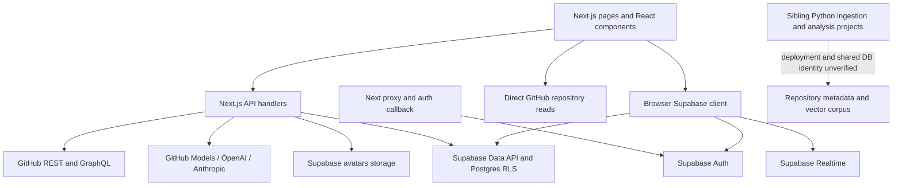

# SEFGH backend map

Inspected: 2026-10-11 (Asia/Calcutta). Source baseline: `42759dd` (`fix: resolve client-side exception on the landing page`). Working tree was clean before this documentation work.

## Evidence boundary

This is a source inspection, not a production audit. Codex traced the key request/data paths, inventoried all API handlers and literal Supabase table/RPC references, and inspected selected sibling Python entry points/configuration/SQL. Claude Code independently reviewed the frontend repository using read-only tools. Neither review executed application endpoints or inspected live database policies, production logs, secrets, or deployed configuration. Not every UI component was read line by line.

`package.json` declares Next.js 16.1.1, React 19.2.0, `@supabase/ssr` ^0.7.0, and `@supabase/supabase-js` ^2.48.1. There are 280 JS/JSX files under `src`, 25 `/api` route files exposing 38 HTTP handlers, plus the auth callback GET outside `/api`. No Rust crate or app database migration directory is present in this checkout. The sole checked-in GitHub workflow updates `LAST_UPDATED.txt`; it does not test the app.

## Current request paths

`src/app/layout.js` mounts authentication, settings, language, and notification providers. `src/proxy.js` refreshes Supabase sessions and protects pages; it excludes `/api`. Protected API handlers call `getUser()` themselves. The auth callback supports both PKCE code exchange and email-link OTP verification.

The main search path is `useGitHubSearch.js` -> `/api/github/search` -> GitHub repository search. Chat uses `/api/ai/chat` and stores conversations through the browser Supabase client. No executable connection from this checkout to the sibling semantic-search API was found in the source search; marketing text mentioning semantic search is not evidence of that integration.

## API inventory

Paths below are relative to `/api`; corresponding source is `src/app/api/<path>/route.js`. This is a migration inventory, not a complete executable OpenAPI contract.

| Path | Methods | Current responsibility / boundary |
|---|---|---|
| `github/search` | GET | Public GitHub search; query/filter/page mapping; `{total_count, items, rate_limit}` |
| `github/repo` | GET | Public `owner` + `name` lookup; selected repository fields; one-hour Next fetch cache |
| `github/repo/[owner]/[repo]` | GET | Repository, languages, README; `{repository, languages, readme, rate_limit}` |
| `github/contents/[owner]/[repo]` | GET | Optional relative `path`; `{contents, rate_limit}` |
| `github/contributions` | GET | Validated username -> GitHub GraphQL -> contribution grid and stats |
| `github/languages` | GET | Local language catalogue |
| `github/trending` | GET | GitHub search transformed into cards; `starsToday` is randomized |
| `github/trending-developers` | GET | User search plus up to 20 repository lookups |
| `ai/chat` | POST | Chat or `action: generate_title`; `{response}` or `{title}`; no handler auth check |
| `ai/suggestions` | POST | Predefined terms and AI fallback; `{suggestions, source?}`; no handler auth check |
| `ai/enhance-query` | POST | Basic fallback, OpenAI or Anthropic; `{enhancedQuery, source}`; no handler auth check |
| `repo/vote` | POST, GET | User vote mutation; public/user-aware aggregate reads; RPC with count fallback |
| `repo/rating` | POST, GET, DELETE | User rating mutations and aggregate reads |
| `repo/comments` | POST, GET, PATCH, DELETE | Comments/replies; owner-scoped edits and soft deletion; public read enrichment |
| `repo/comments/vote` | POST, GET | User comment vote; reads aggregate counters after write |
| `repo/collect` | POST, GET, DELETE | Collections/save status; mutations require user |
| `repo/starred` | GET | Current user's collections plus optional GitHub enrichment; `{repos, count}` |
| `repo/videos` | POST, GET, DELETE | Repository videos; authenticated mutations and public reads |
| `conversations/[id]/share` | POST, DELETE | Owner snapshot of last 50 messages, share RPC, soft revocation |
| `share/[token]` | GET | Public non-deleted snapshot; private-link check |
| `share/[token]/fork` | POST | Authenticated copy of public snapshot into a conversation |
| `playground/keys` | POST | Authenticated random API-key creation; raw key stored in `api_keys` |
| `activity` | GET | Authenticated activity -> contribution-style grid and stats |
| `upload-avatar` | POST | Authenticated multipart upload, Auth metadata/profile update, old-file cleanup |
| `trending/refresh` | POST, GET | POST requires `CRON_SECRET`; deletes/refills database cache; GET reports freshness |

### First-port contract: GitHub search

Source: `src/app/api/github/search/route.js`; consumers include `src/hooks/search/useGitHubSearch.js` and `src/app/chat/page.js`.

- Inputs: required `q`; `sort` defaults to `all`; optional `language`, `stars`; `page` defaults to 1 and `per_page` to 30.
- Sort mapping: `all` -> empty GitHub sort; `latest`, `monthly`, `yearly` -> `updated`; `featured` -> `stars`. These labels do not currently add date filters. Ordinary unknown values fall back to `all`, but inherited object keys such as `constructor` and `__proto__` bypass the fallback and produce undefined sort/order fields. Add fixtures and explicitly fix this during validation work.
- Language uses an allowlist regex. Stars supports a bare `*` and integer/range/comparison syntax. Page is lower-bounded at 1; page size is clamped to 1..100. Current parsing does not enforce finite integers: positive infinite `page` survives, positive infinite `per_page` clamps to 100, and fractions can survive either clamp. Capture stricter parsing as an intentional validation change.
- Success: `{total_count, items, rate_limit: {remaining, reset}}`. Rate-limit fields come from HTTP headers and are strings or null, not numbers. Preserve GitHub repository fields used by cards.
- Missing query: 400 `{error: "Search query is required"}`. Invalid parameters: 400 `{error: "Invalid search parameters"}`. Upstream/network failure currently becomes 500 `{error: "Failed to search repositories"}`, including non-OK 403/429/422 upstream responses. The fetch sets no explicit timeout or cache option.
- Optional server-side `GITHUB_TOKEN`; no user authentication requirement in this handler.
- Record fixtures for success, empty results, filters, pagination, missing inputs, upstream limits and failure before writing the Rust replacement. Explicitly record any improved error/status behavior instead of silently changing it.

## Data access outside API routes

The source references 22 database table names, plus the `avatars` storage bucket. These names are call-site evidence, not confirmation that the live objects exist or are configured correctly.

| Domain | Tables | Main non-route source |
|---|---|---|
| Chat/shares | `user_conversations`, `shared_conversations` | `src/lib/supabase/conversations.js`, `shares.js` |
| Profile/onboarding | `profiles`, `onboarding_data` | `src/lib/supabase/profiles.js`, `onboarding.js`, `src/hooks/profile/useProfileData.js` |
| History/activity | `search_history`, `activity_logs`, `user_stats`, `platform_stats` | `search-history.js`, `activity-logger.js`, `useUserStats.js`, `SearchStats.jsx`; activity table read in API |
| Notifications | `notifications` | `src/contexts/NotificationContext.js`, notification hooks, `src/lib/notifications.js` |
| Discovery/submissions | `projects`, `categories`, `repo_submissions`, `trending_repos` | home hooks, submission hooks/dialog, `src/lib/trending.js` |
| Repository interaction | `repo_votes`, `repo_ratings`, `repo_comments`, `comment_votes`, `repo_collections`, `repo_videos` | `src/lib/repo/sefghData.js`, comment helpers, API handlers |
| Developer playground | `api_keys`, `api_limits`, `api_logs` | `src/components/playground/*Tab.jsx` |

Four RPC names are referenced: `get_repo_vote_stats`, `upsert_shared_conversation`, `log_user_activity`, and `increment_platform_stat`. Their bodies are not versioned here. Comment-vote counters appear to depend on database-side maintenance; verify the triggers rather than assuming them.

Realtime subscriptions exist for conversations, profiles, notifications, projects, categories, and user stats. A complete application-backend migration needs to address these subscriptions and the direct browser reads/writes, not just replace route handlers.

## Sibling projects: discovery only

These live outside this Git repository. They were inspected read-only at their main integration points, not fully audited or modified. Which checkout is authoritative or deployed remains unknown.

| Local project under `D:/SEFGH` | Observed purpose | Migration implication |
|---|---|---|
| `RepoSync` | Python GitHub GraphQL ingestion with rate-limit/backoff handling and Supabase service-role writes; monitoring/dashboard code | Treat as a long-running/checkpointed worker; preserve restart and ingestion semantics |
| `RepoAnalyser` | Python repository analysis with external services and Supabase | Older/parallel implementation; establish active lineage before porting |
| `RepoAnalyser-ai` | Python package, Flask interface, Repomix client, Ollama generation/embedding, database repository layer | Default `nomic-embed-text`, configured 768 dimensions; SQL uses `description_embedding` and `match_repos_cosine/l2/inner` joined to `ReposMeta` |
| `search engine/RepoAnalyser` | FastAPI `/health`, POST `/search`; Google embedding call then Supabase `match_repo_analysis` | SQL uses `embedding vector(768)`; API returns `{results}`; default embedding model string is `models/gemini-embedding-2`, without an explicit output dimension in the inspected call |
| `apiserver` | No top-level entries found | Do not assume it is an implemented service |

The two vector-search implementations have different model families, vector column names, RPCs, and output shapes. Even if vectors share 768 dimensions, they are not interchangeable. Verify active corpus/model, normalization, dimensions, schema, and retrieval quality before consolidation. The FastAPI code and SQL dimension compatibility has not been runtime-tested.

## Findings to account for before porting

1. **Missing database source of truth:** no app schema, RLS policies, RPC definitions, trigger definitions, or bucket policies in this repo. The avatar handler refers to a missing `supabase/avatar-storage-setup.sql`.
2. **AI endpoint controls:** no auth/quotas/rate limits in the three inspected AI handlers; page protection does not cover them. Check deployed external controls before claiming production exposure.
3. **Playground key lifecycle:** keys are stored/read in plaintext, usage logging is partly browser-written, and no source handler was found verifying these generated keys. A Rust public API needs a real key-verification and server-side accounting design.
4. **Session-sensitive paths:** existing SSR cookie refresh must keep working during a port; avoid replacing it with custom cookie parsing.
5. **Conversation concurrency:** message editing/deletion reads and rewrites an entire JSON array. Concurrent writers can lose updates. Port with a tested atomic operation or optimistic concurrency strategy.
6. **Latency independent of language:** first-message title generation is awaited before the main chat request (`useChatMessages.js`); `streamAIResponse` is a stub (`src/lib/ai/github.js`). GitHub detail enrichment and comment profile/reply queries introduce extra requests.
7. **Trending refresh:** server route uses `src/lib/trending.js`, which imports the browser client and has no explicit server user/service identity. POST checks a cron secret but DB authorization is separate. It clears rows before fetching replacements; failure can leave an empty/partial cache. Do not put this into a stateless first slice.
8. **Comments:** `auth.admin.getUserById` is attempted with the ordinary anon-key client in the API and shared helpers. Do not add admin access merely to expose commenter emails; define a public profile projection.
9. **Cache and upstream identity:** some GitHub paths include a token and Next-specific cache settings, others do not. Rust needs explicit cache/timeout/concurrency/rate-limit behavior. A language change alone does not address upstream limits.
10. **Incomplete feature evidence:** randomized trending star counts, a stub `src/lib/supabase/mcp.js`, and a call to missing `/api/log-error` must not be described as production-complete integrations.

## Validation performed

Source enumeration, route/method counting, table/RPC call-site extraction, selected source tracing, and independent Claude Code review. No build, lint baseline, endpoint integration test, live Supabase query, corpus benchmark, or production deployment check was run for this documentation-only change. There is no `test` script in `package.json`; this is a test-coverage gap, not proof of passing behavior.
