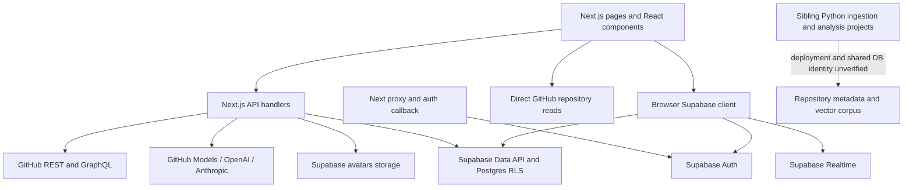

# SEFGH backend map

Update 2026-10-18 (AVATAR-001a/b): `POST /api/upload-avatar` has 45 recorded
cases and a default-off standard-library Go port in `backend/internal/avatar`.
The browser sends its session bearer. Storage upload/list/remove, Auth metadata
and own-profile writes use that same user identity. Cleanup selection and partial
writes are preserved; Go bounds cleanup before responding. See
[the contract](../contracts/upload-avatar/README.md) for explicit differences
and R-094 to R-096. No live Storage write, schema change or cutover performed.

Update 2026-10-18 (BATCH-001): R-039 direction is real hashed, show-once keys
with supported-endpoint validation and server accounting; see
[the key plan](plans/playground-keys.md). The plaintext route is not ported or
changed yet. The connector denied a catalog-only schema query, so
`supabase/checks/keys_001_catalog.sql` is an unexecuted read-only preflight,
not a verified schema or an applied migration. R-090 is explicitly scheduled
by the owner for Go after cutover; current share deletion behavior remains.

Update 2026-10-13: AUTH-001 verifies Supabase and GitHub bearer credentials for
the five migrated dynamic GitHub handlers; anonymous requests use no server
token. Private responses are not cached. Go protects direct requests too.
No private browser integration or deployment occurred. Shared localStorage
and chat/share flows need isolation before receiving private results. Other
server-token helpers/starred routes remain outside this slice. CI-001 adds
a Linux workflow; VERIFY-002 adds production forwarding coverage. Actual test
results and gates are in coordination.md. The sections below retain their
dated historical evidence. See [access contract](../contracts/github-access/README.md).

Inspected: 2026-10-11 (Asia/Calcutta). Source baseline: `42759dd` (`fix: resolve client-side exception on the landing page`). Working tree was clean before this documentation work.

## Evidence boundary

This is a source inspection, not a production audit. Codex traced the key request/data paths, inventoried all API handlers and literal Supabase table/RPC references, and inspected selected sibling Python entry points/configuration/SQL. Claude Code independently reviewed the frontend repository using read-only tools. Neither review executed application endpoints or inspected live database policies, production logs, secrets, or deployed configuration. Not every UI component was read line by line.

`package.json` declares Next.js 16.1.1, React 19.2.0, `@supabase/ssr` ^0.7.0, and `@supabase/supabase-js` ^2.48.1. There are 280 JS/JSX files under `src`, 25 `/api` route files exposing 38 HTTP handlers, plus the auth callback GET outside `/api`. No app database migration directory is present in this checkout. The sole checked-in GitHub workflow updates `LAST_UPDATED.txt`; it does not test the app.

Current implementation update (2026-10-12, GO-004): the standard-library Go
backend in `backend/` implements search, repository summary, repository detail
and contents, plus the static language catalog and (GO-005b) contributions,
under `adr/0002-go-backend.md`.
All six remain off by default;
every route below still has its Next.js handler. GO-003 adds shared failure
results and panic recovery to the per-process summary cache, structured
upstream failure logging, and wire-path preservation for `|`/`^` beside encoded
slashes. These are local implementation changes, not a deployed topology.

GO-004 begins Phase 2 with `/api/github/languages`: an embedded immutable JSON
array matching all 565 names in `src/data/github-languages.js`, including order.
It needs no runtime data file, upstream HTTP call, token or database access.
The browser consumer remains `src/app/trending/page.js`; the Next handler stays.

FIX-003 (2026-10-12) added input validation to the three repository routes, in
the Next.js handlers (`src/lib/github/repo-identifiers.js`) and the Go ports
together, at repository contract version 3. An invalid owner, name or path now
answers 400 without any request to GitHub. Before this, `owner=..` could reach
other GitHub endpoints with the server token. Hosting is Vercel and Supabase by
the owner's statement; the deployment has not been inspected.

GO-005a (2026-10-12) recorded `/api/github/contributions` as contract version 1
in `../contracts/github-contributions/`. GO-005b ported it to
`backend/internal/githubcontributions`, off by default, reproducing the recorded
behaviour including its defects. What the recording
found: no page or component in this checkout calls the route; its date range is
computed in the server's time zone, so the same instant gives different ranges
on differently configured servers; it passes GitHub's status code through to
the caller; and it is public while spending the server token's GraphQL
allowance, with no rate limit or cache. Eighteen cases are marked `defect`.

The shared fixtures now contain 89 search cases, 124 repository cases, 3
language-catalog cases and 95 contributions cases. `npm run test:contracts` runs 317 checks including fixture-integrity and rewrite
checks; Go exercises every case in memory and over local sockets. See
`coordination.md` for actual checks and the remaining cutover gates. The
historical validation section below describes the earlier snapshot only.

## Current request paths

`src/app/layout.js` mounts authentication, settings, language, and notification providers. `src/proxy.js` refreshes Supabase sessions and protects pages; it excludes `/api`. Protected API handlers call `getUser()` themselves. The auth callback supports both PKCE code exchange and email-link OTP verification.

The main search path is `useGitHubSearch.js` -> `/api/github/search` -> GitHub repository search. Chat uses `/api/ai/chat` and stores conversations through the browser Supabase client. No executable connection from this checkout to the sibling semantic-search API was found in the source search; marketing text mentioning semantic search is not evidence of that integration.

## API inventory

Paths below are relative to `/api`; corresponding source is `src/app/api/<path>/route.js`. This is a migration inventory, not a complete executable OpenAPI contract.

| Path | Methods | Current responsibility / boundary |
|---|---|---|
| `github/search` | GET | Public GitHub search; query/filter/page mapping; `{total_count, items, rate_limit}` |
| `github/repo` | GET | Public `owner` + `name` lookup; selected repository fields; one-hour Next fetch cache |
| `github/repo/[owner]/[repo]` | GET | Repository, languages, README; `{repository, languages, readme, rate_limit}` |
| `github/contents/[owner]/[repo]` | GET | Optional relative `path`; `{contents, rate_limit}` |
| `github/contributions` | GET | Validated username -> GitHub GraphQL -> contribution grid and stats |
| `github/languages` | GET | Local language catalogue |
| `github/trending` | GET | GitHub search transformed into cards; `starsToday` is randomized |
| `github/trending-developers` | GET | User search plus up to 20 repository lookups |
| `ai/chat` | POST | Chat or `action: generate_title`; `{response}` or `{title}`; no handler auth check |
| `ai/suggestions` | POST | Predefined terms and AI fallback; `{suggestions, source?}`; no handler auth check |
| `ai/enhance-query` | POST | Basic fallback, OpenAI or Anthropic; `{enhancedQuery, source}`; no handler auth check |
| `repo/vote` | POST, GET | User vote mutation; public/user-aware aggregate reads; RPC with count fallback |
| `repo/rating` | POST, GET, DELETE | User rating mutations and aggregate reads |
| `repo/comments` | POST, GET, PATCH, DELETE | Comments/replies; owner-scoped edits and soft deletion; public read enrichment |
| `repo/comments/vote` | POST, GET | User comment vote; reads aggregate counters after write |
| `repo/collect` | POST, GET, DELETE | Collections/save status; mutations require user |
| `repo/starred` | GET | Current user's collections plus optional GitHub enrichment; `{repos, count}` |
| `repo/videos` | POST, GET, DELETE | Repository videos; authenticated mutations and public reads |
| `conversations/[id]/share` | POST, DELETE | Owner snapshot of last 50 messages, share RPC, soft revocation |
| `share/[token]` | GET | Public non-deleted snapshot; private-link check |
| `share/[token]/fork` | POST | Authenticated copy of public snapshot into a conversation |
| `playground/keys` | POST | Authenticated random API-key creation; raw key stored in `api_keys` |
| `activity` | GET | Authenticated activity -> contribution-style grid and stats |
| `upload-avatar` | POST | Authenticated multipart upload, Auth metadata/profile update, old-file cleanup |
| `trending/refresh` | POST, GET | POST requires `CRON_SECRET`; deletes/refills database cache; GET reports freshness |

### First-port contract: GitHub search

Source: `src/app/api/github/search/route.js`; consumers are `src/hooks/search/useGitHubSearch.js` and `src/app/chat/page.js`. The contract is recorded as data in `../contracts/github-search/cases.json`. The README beside it is the single description of the rules, so they are not repeated here.

- Contract version 2 (2026-10-11): the owner approved fixing all 13 defects recorded in version 1. The handler and the fixtures changed in the same commit.
- Optional server-side `GITHUB_TOKEN`; no user authentication requirement. The Next.js handler sets no timeout or cache option on its fetch.
- The search page shows the API's `error` text to the user in a toast, so error wording is part of the UI.

Open findings, recorded and not fixed:

- The search navbar sends `sort=stars` and `sort=updated`, names the API does not know, so "Most Stars" and "Recently Updated" silently behave as `all`. Pinned as `defect` cases awaiting an owner decision. The `SearchFilters` panel uses the API's own names and works.
- `monthly` and `yearly` add no date filter; they behave exactly like `latest`.
- The navbar's advanced filters (license, date range, topics, forks, wiki, issues) are held in UI state and never sent to the API.
- The UI offers "load more" while it holds fewer results than `total_count`, but GitHub serves only the first 1000. Requests past that now answer 400 where they used to answer 500.

## Data access outside API routes

The source references 22 database table names, plus the `avatars` storage bucket. These names are call-site evidence, not confirmation that the live objects exist or are configured correctly.

| Domain | Tables | Main non-route source |
|---|---|---|
| Chat/shares | `user_conversations`, `shared_conversations` | `src/lib/supabase/conversations.js`, `shares.js` |
| Profile/onboarding | `profiles`, `onboarding_data` | `src/lib/supabase/profiles.js`, `onboarding.js`, `src/hooks/profile/useProfileData.js` |
| History/activity | `search_history`, `activity_logs`, `user_stats`, `platform_stats` | `search-history.js`, `activity-logger.js`, `useUserStats.js`, `SearchStats.jsx`; activity table read in API |
| Notifications | `notifications` | `src/contexts/NotificationContext.js`, notification hooks, `src/lib/notifications.js` |
| Discovery/submissions | `projects`, `categories`, `repo_submissions`, `trending_repos` | home hooks, submission hooks/dialog, `src/lib/trending.js` |
| Repository interaction | `repo_votes`, `repo_ratings`, `repo_comments`, `comment_votes`, `repo_collections`, `repo_videos` | `src/lib/repo/sefghData.js`, comment helpers, API handlers |
| Developer playground | `api_keys`, `api_limits`, `api_logs` | `src/components/playground/*Tab.jsx` |

Four RPC names are referenced: `get_repo_vote_stats`, `upsert_shared_conversation`, `log_user_activity`, and `increment_platform_stat`. Their bodies are not versioned here. Comment-vote counters appear to depend on database-side maintenance; verify the triggers rather than assuming them.

Realtime subscriptions exist for conversations, profiles, notifications, projects, categories, and user stats. A complete application-backend migration needs to address these subscriptions and the direct browser reads/writes, not just replace route handlers.

## Sibling projects: discovery only

These live outside this Git repository. They were inspected read-only at their main integration points, not fully audited or modified. Which checkout is authoritative or deployed remains unknown.

| Local project under `D:/SEFGH` | Observed purpose | Migration implication |
|---|---|---|
| `RepoSync` | Python GitHub GraphQL ingestion with rate-limit/backoff handling and Supabase service-role writes; monitoring/dashboard code | Treat as a long-running/checkpointed worker; preserve restart and ingestion semantics |
| `RepoAnalyser` | Python repository analysis with external services and Supabase | Older/parallel implementation; establish active lineage before porting |
| `RepoAnalyser-ai` | Python package, Flask interface, Repomix client, Ollama generation/embedding, database repository layer | Default `nomic-embed-text`, configured 768 dimensions; SQL uses `description_embedding` and `match_repos_cosine/l2/inner` joined to `ReposMeta` |
| `search engine/RepoAnalyser` | FastAPI `/health`, POST `/search`; Google embedding call then Supabase `match_repo_analysis` | SQL uses `embedding vector(768)`; API returns `{results}`; default embedding model string is `models/gemini-embedding-2`, without an explicit output dimension in the inspected call |
| `apiserver` | No top-level entries found | Do not assume it is an implemented service |

The two vector-search implementations have different model families, vector column names, RPCs, and output shapes. Even if vectors share 768 dimensions, they are not interchangeable. Verify active corpus/model, normalization, dimensions, schema, and retrieval quality before consolidation. The FastAPI code and SQL dimension compatibility has not been runtime-tested.

## Findings to account for before porting

1. **Missing database source of truth:** no app schema, RLS policies, RPC definitions, trigger definitions, or bucket policies in this repo. The avatar handler refers to a missing `supabase/avatar-storage-setup.sql`. *SEC-001 (2026-10-15): User-DB's live definitions are now recorded in `database/user-db.md` (a snapshot, not a schema), and database changes go in `../supabase/migrations/`. Repo-DB is not yet reviewed.*
2. **AI endpoint controls:** no auth/quotas/rate limits in the three inspected AI handlers; page protection does not cover them. Check deployed external controls before claiming production exposure.
3. **Playground key lifecycle:** keys are stored/read in plaintext, usage logging is partly browser-written, and no source handler was found verifying these generated keys. A Go public API needs a real key-verification and server-side accounting design.
4. **Session-sensitive paths:** existing SSR cookie refresh must keep working during a port; avoid replacing it with custom cookie parsing.
5. **Conversation concurrency:** message editing/deletion reads and rewrites an entire JSON array. Concurrent writers can lose updates. Port with a tested atomic operation or optimistic concurrency strategy.
6. **Latency independent of language:** first-message title generation is awaited before the main chat request (`useChatMessages.js`); `streamAIResponse` is a stub (`src/lib/ai/github.js`). GitHub detail enrichment and comment profile/reply queries introduce extra requests.
7. **Trending refresh:** server route uses `src/lib/trending.js`, which imports the browser client and has no explicit server user/service identity. POST checks a cron secret but DB authorization is separate. It clears rows before fetching replacements; failure can leave an empty/partial cache. Do not put this into a stateless first slice.
8. **Comments:** `auth.admin.getUserById` is attempted with the ordinary anon-key client in the API and shared helpers. Do not add admin access merely to expose commenter emails; define a public profile projection.
9. **Cache and upstream identity:** some GitHub paths include a token and Next-specific cache settings, others do not. Each Go port needs explicit cache/timeout/concurrency/rate-limit behavior. A language change alone does not address upstream limits.
10. **Incomplete feature evidence:** randomized trending star counts, a stub `src/lib/supabase/mcp.js`, and a call to missing `/api/log-error` must not be described as production-complete integrations.

## Validation performed

The source-inspection claims below describe the original assessment. Claude later reported local endpoint, switch and production-build checks for GO-001 in `coordination.md`; those are separate from a production deployment audit. Codex's 2026-10-12 synchronization checks are recorded there separately. Do not read the original "no endpoint integration test" statement as covering those later tasks.

Source enumeration, route/method counting, table/RPC call-site extraction, selected source tracing, and independent Claude Code review. No endpoint integration test, live Supabase query, corpus benchmark, or production deployment check was run. The only automated tests are the GitHub search contract suite, run against both the Next.js handler (`npm run test:contracts`) and the Go handler (`go test ./...` in `backend/`), and the Go unit tests. Every other handler remains untested.

Baseline recorded on 2026-10-11 by Claude Code at `42759dd` application source, Node 21.7.1, npm 10.5.0, Windows, with the local environment file present:

- `npm run lint`: **fails**, exit 1, 10 errors and 16 warnings. All 10 errors are `react-hooks/set-state-in-effect` in UI files: `src/app/page.js`, `src/components/3d/ThreeBackground.jsx`, `src/components/Canvas.jsx` (2), `src/components/CookieBar.jsx`, `src/components/settings/AccountTab.jsx`, `src/components/settings/SessionsTab.jsx`, `src/components/usage-contributions/UsageContributionsCard.jsx`, `src/contexts/LanguageContext.js` (2). Warnings: 13 `react-hooks/exhaustive-deps`, 2 `@next/next/no-img-element`, 1 `react-hooks/unsupported-syntax`. None is in an API handler.
- `npm run build`: **passes**, exit 0.
- No latency, resource, or cost measurement was taken.

## AUTH-002 and GO-006a implementation update (2026-10-13)

The repository page's fetchRepoFromGitHub helper and /api/repo/starred GitHub
enrichment now use the same public-only validated no-store read. The starred
route retains Supabase getUser and user_id scoping. It refreshes stored metadata
in batches of four, returns null enrichment on denied/unavailable repositories,
and marks successful replies private/no-store. It writes no database rows.
No other server-token consumer or browser private-data flow is claimed fixed.

Trending now has 33 characterization fixtures; its source and Go route inventory
are unchanged. AUTH-002 needs review and anonymous quota measurement. Automatic
Vercel deployment state has not been inspected. Historical snapshots above do
not establish the current deployment or absence of the CI-001 workflow.

## GO-006b update (2026-10-13)

Seven Go routes now exist: trending joins search, languages, contributions,
summary, detail and contents. All remain opt-in. Trending is public-only and
bypasses the identity verifier while sending no credential upstream, matching
Next.js. Clock/random injection pins the 33 fixtures; known defects remain.
No browser, Supabase, worker or deployment boundary changes.

## GO-007a characterization (2026-10-13)

Trending-developers has 48 contract fixtures (17 defect), invoked by
src/hooks/trending/useTrendingData.js. Its search fans out to at most twenty
repository reads. HTTP enrichment failures create fallback cards; transport
or malformed-JSON failures may fail the whole response. No credential is sent.
Source behavior and the seven-route Go inventory are unchanged. GO-007b is next.

## GO-007b / AI-001a update (2026-10-13)

Eight Go routes now include trending-developers, public-only, default-off, with
four enrichment slots and joined workers. AI suggestions has 32 fixture cases
at the generateAIResponse boundary; no AI provider integration or production
AI behavior changed. Browser/Supabase/worker/deployment boundaries unchanged.

## REVIEW-005 update (2026-10-13)

Trending developers is ported (eight Go routes, all opt-in) and reviewed by
Claude Code. `backend/internal/jscompat/json.go` adds `DecodeJSON`, used by the
trending and trending-developers handlers to read GitHub replies as
`response.json()` does. Both handlers take a logger and record why a request
failed. Fixture counts are now 57 for trending developers (23 defect), 34 for
trending and 35 for AI suggestions. No browser, Supabase, worker or deployment
boundary changed. Findings are in `claude-review.md` under REVIEW-005.

## AI-001b / AI-001c update (2026-10-13)

All three AI routes are characterized; none is ported. `ai/enhance-query`
calls OpenAI or Anthropic directly from its handler with `OPENAI_API_KEY` or
`ANTHROPIC_API_KEY`. `ai/chat` and `ai/suggestions` go through
`src/lib/ai/github.js`, which calls GitHub Models with `GITHUB_TOKEN`. None of
the three checks the caller or limits use. Fixtures: `contracts/ai-suggestions`
(35), `contracts/ai-enhance-query` (62), `contracts/ai-chat` (42). No provider
was contacted and no live key, usage or deployment was inspected. The Go
inventory is unchanged at eight routes.

## REVIEW-006 update (2026-10-13)

`backend/cmd/api/main.go` builds the whole server in `newHandler`; `run` and the
tests both call it. `backend/internal/githubaccess` reads issuer replies with
`jscompat.DecodeJSON` and checks them field by field, matching
`src/lib/github/access.js`, which now skips malformed identity entries and
treats only status 200 as an answer. Shared access cases: 35. No route, browser,
Supabase, worker or deployment boundary changed. Details in `claude-review.md`
under REVIEW-006.

## AI-002a update (2026-10-13)

The three AI handlers changed in Next.js; none is ported. `ai/chat` now needs
a signed-in user: `src/lib/ai/session.js` verifies a bearer token online with
Supabase through `src/lib/supabase/verify-bearer.js`, or falls back to the
app's cookie session. `src/lib/ai/guard.js` holds the limits, a per-process
request counter, and the check that reduces chat messages to `role` and
`content`. `src/lib/github/access.js` exports `askIssuer`, the one bounded
identity call both checks share. Contracts: `ai-chat` 78 cases, `ai-enhance-query`
73, `ai-suggestions` 44, all version 2. No Go, browser, database or deployment
boundary changed. The browser still calls chat with its cookie.

## AI-002b update (2026-10-14)

Ten Go routes exist: the eight GitHub reads plus `ai/suggestions` and
`ai/enhance-query`. All remain opt-in. `backend/cmd/api/main.go` serves the AI
routes from `aiMux`, beside the GitHub access check; `ai/chat` is not ported
and answers 404 from Go. New packages: `backend/internal/ailimit`,
`aiprovider`, `aisuggestions`, `aienhance`, and `aitest` for test support.
`jscompat` gains JavaScript's trim, lower-casing, string length and
`JSON.parse`. The Go server reads `GITHUB_TOKEN` (GitHub Models only),
`OPENAI_API_KEY` and `ANTHROPIC_API_KEY`. No browser, database or deployment
boundary changed.

## AI-002c update (2026-10-14)

Eleven Go routes exist: the eight GitHub reads and all three AI routes. All
remain opt-in; `ai/chat` is `ai-chat`. New package `backend/internal/aichat`;
`githubaccess.Verifier.SignedInUser` asks Supabase Auth who a bearer belongs
to; `jscompat.UTF16` holds text as JavaScript does.

One browser boundary changed: `src/hooks/chat/useChatMessages.js` now calls
chat through `src/lib/ai/chat-request.js`, which reads the Supabase session
in the browser and sends its access token as `Authorization: Bearer`, to the
same-origin `/api/ai/chat` only. It is the first browser code to send a
Supabase token to this application's own API. Next.js already accepted it,
and still falls back to its cookie when none is sent. Conversations are
still stored by the browser Supabase client; no database boundary changed.

## QUOTA-001 and Phase 6 update (2026-10-14)

Signed-out GitHub reads can use a server token of their own,
`GITHUB_PUBLIC_READ_TOKEN`, distinct from `GITHUB_TOKEN`, once GitHub confirms
it is a classic token with no scopes. Next.js: `src/lib/github/public-token.js`,
used by `githubFetch` for signed-out callers, by the trending and
trending-developers routes, and by `src/lib/repo/repoData.js`. Go:
`backend/internal/publictoken`, a transport on the signed-out handlers'
clients only. Unset, every path is as before. Contributions is not covered.
The GitHub token boundary is now: a verified caller's own token for their
reads; the checked public token, or none, for signed-out reads; `GITHUB_TOKEN`
only for GitHub Models.

The plan gained Phase 6, bugs and broken UI/UX, recorded in `bug-register.md`.

## BUG-003 update (2026-10-14)

No route or data boundary changed. The profile's usage card now reads the
signed-in user's activity from `GET /api/activity` instead of generating mock
data; that route, which reads `activity_logs` with the user's own Supabase
session, has its first browser caller. `src/hooks/useBrowser.js` holds the
hooks the UI uses to read browser-only values (localStorage, media queries)
without setting state inside an effect.

## BUG-004 / BUG-005 / ACT-001 update (2026-10-14)

`contracts/activity` records `GET /api/activity` (reads `activity_logs`
through the user's cookie-session client), the first Phase 3 contract. The
trending route's reply changed shape at contract version 2: `starsPerDay`
replaced `starsToday`, in both backends. Google Analytics now loads from a
client component, `src/components/GoogleAnalytics.jsx`, only after consent
stored by `src/lib/consent.js`. The Sessions tab calls Supabase's
`signOut({ scope: "global" })`; every other sign-out uses `"local"`.

## BUG-006 / ACT-002 update (2026-10-14)

`GET /api/activity` has a Go port, `backend/internal/activity`, off by default
(switch `activity`). It is the first Go route that reads the database: one
`GET /rest/v1/activity_logs` to the Supabase Data API, with the caller's own
access token and the project's public key, so the table's row-level security
applies as it does to the Next.js handler's cookie-session client. No service
key exists in either backend. `githubaccess.Verifier.User` verifies the
bearer and hands it back for that call. The browser's usage card and chat
both send the bearer through `src/lib/supabase/session-fetch.js`.

Browser-only changes (BUG-006): Google Analytics loads for every visitor who
has not opted out (`src/lib/consent.js` value "declined"), and both footers
have "Cookie settings". Dates are formatted en-IN everywhere. Search paging
stops at the last page GitHub serves (`src/lib/github/search-pages.js`).
The trending Star button links to GitHub (`src/lib/utils/trending/githubLink.js`).

## STAR-001 update (2026-10-15)

`GET /api/repo/starred` has a Go port, `backend/internal/starred`, off by default (switch `repo-starred`). It reads `repo_collections` (`select *`, the caller's rows, newest first) through `internal/supabaserest` with the caller's own token. It then reads each repository from GitHub through the signed-out transport, at most four at once, within a 14-second budget for the request. `internal/supabaserest` now holds the Data API request and the supabase-js reading of replies for both activity and starred. `githubrepos.ValidOwner` and `ValidRepoName` export the owner and name rules to other packages. The starred page sends the bearer through `src/lib/supabase/session-fetch.js`.

Hosting (OPS-004): the website is Vercel project `sefgh-main` and the Go service is `sefgh-api` (`https://sefgh-api.vercel.app`). Both are in team "sefghai's projects" and built from `github.com/sefgh-ai/sefgh-main`. No route is switched to Go on the website yet.

## SEC-001 update (2026-10-15)

User-DB's definitions were read from the live project: `database/user-db.md`.
Nothing about the request path changed. Two things are new:

- `supabase/` holds database changes as migrations, each with a read-only
  verify query and a rollback in `supabase/checks/`. The first,
  `20261015140000_sec_001_close_data_exposures.sql`, is not applied; it
  waits for the owner.
- Browsers may read only some `profiles` columns once it is applied, so
  profile reads name them through `src/lib/supabase/profile-columns.js`. A
  Go route that reads profiles must name the same columns.

`activity_logs` and `repo_collections` let a user read only their own rows,
which is what the Go activity and starred ports assume.

## SEC-001b update (2026-10-15)

In production, `sefgh-main` now forwards `GET /api/github/trending` to the
Go service `https://sefgh-api.vercel.app` (`SEFGH_GO_ROUTES=github-trending`).
Every other route is still answered by Next.js. The SEC-001 migration is
applied on User-DB: browsers can read every `profiles` column except
`email`.

## SHARE-001 update (2026-10-16)

`GET /api/share/[token]` has a Go port, `backend/internal/sharetoken`, off by
default (switch `share-token`). It asks the Data API with the visitor's
bearer when there is one and the public key otherwise, without a Supabase
Auth call, so row-level security decides as for the Next.js handler's
cookie client. `src/app/s/[token]/page.js` now sends the bearer
(`fetchWithSession`). `POST /api/share/[token]/fork` stays in Next.js.
`supabaserest.Param` writes URLs with URLSearchParams' encoding
(`jscompat.FormEncode`) for every route.

## COLLECT-001 update (2026-10-17)

`/api/repo/collect` (GET, POST, DELETE) has a Go port,
`backend/internal/collect`, off by default (switch `repo-collect`). It is
the first Go route that writes to the database: `supabaserest.Insert` and
`Delete` send the caller's own token, so row-level security decides each
write. The bookmark button, the repository card and the starred page now
send the bearer (`fetchWithSession`). `githubaccess.SessionToken` is the
one rule for reading a bearer.

## VOTE-001 update (2026-10-17)

`/api/repo/vote` (GET, POST) has a Go port, `backend/internal/vote`, off by
default (switch `repo-vote`). Writes go as the caller (`supabaserest.Upsert`,
`Delete`); the stats function is called with `supabaserest.RPC` and, as on
the live database, fails, so the votes are counted by hand. The vote arrows
send the bearer (`fetchWithSession`).

## RATING-001 update (2026-10-17)

`/api/repo/rating` (GET, POST, DELETE) has a Go port, `backend/internal/rating`,
off by default (switch `repo-rating`). Writes go as the caller; JavaScript's
loose comparisons and `+` are copied by `jscompat`. The rating form sends the
bearer (`fetchWithSession`).

## CVOTE-001 update (2026-10-17)

`/api/repo/comments/vote` (GET, POST) has a Go port, `backend/internal/commentvote`,
off by default (switch `comment-vote`). The comment vote arrows send the
bearer (`fetchWithSession`); the other comment calls still go to Next.js.

## COMMENTS-001 update (2026-10-17)

`/api/repo/comments` (GET, POST, PATCH, DELETE) has a Go port,
`backend/internal/comments`, off by default (switch `repo-comments`). Its GET
reads each comment's details concurrently (four at once, one budget). The
comment form, edit and delete send the bearer (`fetchWithSession`). The list
the page shows is still read in the browser (`commentHelpers.js`).

## VIDEOS-001 update (2026-10-17)

`/api/repo/videos` (GET, POST, DELETE) has a Go port, `backend/internal/videos`,
off by default (switch `repo-videos`). Its GET reads each video's uploader
concurrently (four at once, one budget). The admin lookup that comments and
videos share is `supabaserest.AdminUserEmail`. The video tab
(`RepoVideoTab.jsx`) sends the bearer (`fetchWithSession`) for all three
calls.

## SHARE-002 update (2026-10-17)

`/api/conversations/[id]/share` (POST, DELETE) and `/api/share/[token]/fork`
(POST) have a Go port, `backend/internal/shares`, off by default (switches
`conversation-share` and `share-fork`). The share dialog and the fork button
send the bearer (`fetchWithSession`). `src/lib/supabase/shares.js` calls the
same function and table straight from the browser, but nothing imports it
(checked at SHARE-002).
