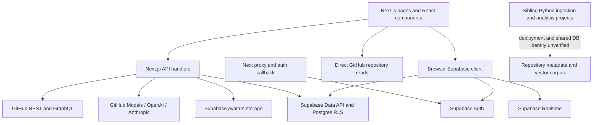

# SEFGH backend map

**Current boundary inventory (P7-10a, 2026-11-03):** [Next.js, Go and managed-service responsibilities](migration-boundaries.md). It supersedes earlier dated switch/fallback descriptions below. P7-07 and the AI part of P7-09 remain gated by R-038/R-213; Phase 7 stays open. Removing a retired route name cannot restore a deleted handler: rollback requires reverting the relevant commit and redeploying.

P7-09a (2026-11-03): the trending-topics and playground-keys-v1 names are
removed from SEFGH_GO_ROUTES selection. `/api/trending/topics` always forwards
when SEFGH_GO_API_URL is configured. V1 `/api/v1/keys`, its selector child,
and `/api/v1/search` forward with the Go origin and exact
NEXT_PUBLIC_SEFGH_KEYS_V1=1, independent of route names. That UI flag is retained;
Go SEFGH_KEYS_V1, accountant credentials and approved-policy checks are unchanged.
The legacy `/api/playground/keys` handler remains; no keys activation, signing,
SQL or hosted acceptance is performed. Only the3AI names still use
SEFGH_GO_ROUTES; their handlers/switches stay until P7-07/R-038/R-213.
Without the origin there are no Go rewrites. Without the UI flag, v1 is not
forwarded. A disabled Go v1 runtime still returns404/no-store; missing runtime
configuration/policy fails closed503. This is limited P7-09a, not full P7-09
or Phase7 completion. Rollback: revert this step and redeploy the website.
[Read-only production preflight](verification/p7-09a-routing-2026-11-03.json)
observed topics200/Go, website v1 paths404 without the Go marker, direct Go
v1 paths404/no-store. No deployment or hosted mutation is implied.

P7-08b (2026-11-03): the browser's and the server's Supabase clients always send
the nine data-proxy areas' tables through Go (`src/lib/supabase/data-routing.js`);
there is no switch and no direct fallback. `NEXT_PUBLIC_SEFGH_GO_DATA` is no longer
read anywhere, and the server-side `goData` option is gone: every server client is
routed. Without SEFGH_GO_API_URL, proxied requests fail (503 on the server, 404 in
the browser) instead of reaching Supabase. Contracts and Go unchanged.
[Production prerequisite receipt](verification/p7-08b-data-proxy-2026-11-03.json).
Rollback: revert the P7-08b commit and redeploy the website.

P7-08a (2026-11-02): the browser modules for search history and onboarding
(`src/lib/supabase/{search-history,onboarding}.js`) lost their direct Supabase
path and ask only Go; a missing Go route is now an ordinary failure, never a
direct database call. Their rewrites are unconditional when SEFGH_GO_API_URL is
configured; `search-history` and `onboarding` in NEXT_PUBLIC_SEFGH_GO_DATA are
ignored. The unused, broken `resetOnboarding` is removed. Contracts unchanged.
[Production prerequisite receipt](verification/p7-08a-browser-data-2026-11-02.json).
Rollback: revert the P7-08a commit and redeploy the website.

P7-06 (2026-11-02): the Next.js handler for `/api/upload-avatar` is retired.
Go answers it alone and keeps every case of the contract; the rewrite is
unconditional when SEFGH_GO_API_URL is configured, and the old switch name is
ignored. Without a Go origin the path is 404. Go is now the only avatar upload
writer, which the R-095 lock protocol requires; its hosted acceptance gates stay
open. [Production prerequisite receipt](verification/p7-06-avatar-2026-11-02.json).
Rollback: revert the P7-06 commit and redeploy both projects.

P7-05 (2026-11-02): the Next.js handlers for `/api/repo/collect`, `/vote`,
`/rating`, `/comments`, `/comments/vote` and `/videos` are retired. The
repository page keeps its session-aware URLs; Go keeps all behaviour and every
case of the six contracts. Rewrites are unconditional when SEFGH_GO_API_URL is
configured; the six old switch names are ignored. Without a Go origin these
paths are 404. [Production prerequisite receipt](verification/p7-05-interactions-2026-11-02.json).
Rollback: revert the P7-05 commit and redeploy both projects.

P7-04 (2026-11-02): the Next.js handlers for `/api/activity` and
`/api/repo/starred` are retired. The profile card and the starred page keep
their session-aware URLs; Go keeps all behaviour, and the activity (16) and
repo-starred (14) contract cases. Rewrites are unconditional when
SEFGH_GO_API_URL is configured; the old `activity` and `repo-starred` switch
names are ignored. Without a Go origin these paths are 404. The activity
reference model that Go's 400-input test compares with now stands alone
(it was checked identical to the handler-based answers before removal).
[Production prerequisite receipt](verification/p7-04-user-reads-2026-11-02.json).
Rollback: revert the P7-04 commit and redeploy both projects.

P7-03 (2026-11-02): the Next.js handlers for `/api/share/[token]`,
`/api/share/[token]/fork` and `/api/conversations/[id]/share` are retired.
The shared page and ShareDialog keep their session-aware URLs; Go keeps
all behavior/authorization and92contract cases. Rewrites are unconditional
when SEFGH_GO_API_URL is configured; old share-token/share-fork/conversation-share
switch names are ignored. Without a Go origin these API paths are404.
Local development needs a local Go server or https://sefgh-api.vercel.app.
The unused browser shares module and legacy Next share recorders/fixture
runner are removed; shared session/server helpers remain in use.
[Production prerequisite receipt](verification/p7-03-shares-2026-11-02.json)
uses a missing-share GET and wrong-method GETs only, with Go markers.
No live share writes, deployment or signed-in browser acceptance were done.
Rollback: revert the P7-03 commit and redeploy both projects. Earlier Next
share handler/switch/recorder descriptions below are historical.

P7-02 (2026-11-02): seven public GitHub Next.js handlers are retired:
search, languages, trending, trending developers, repository summary/details
and contents. Their URLs still reach the retained Go implementations through
unconditional rewrites whenever `SEFGH_GO_API_URL` is configured. Without that
origin these URLs are404; local development must point it at a local Go
server or `https://sefgh-api.vercel.app`. The repository page and metadata
also require the Go origin and no longer fall back to GitHub. Their old
`github-public-repo` switch is ignored. The direct GitHub helper stays only
for the Next starred handler until P7-04; shared issuer/public-token/identifier
helpers remain where still used. All408Go contract cases remain; Next-only
fields/runners and orphan language catalog/trending measure code are removed.
[Production routing prerequisite](verification/p7-02-public-reads-2026-11-02.json):
all seven website paths answered from Go; server-only public-repo was checked
on sefgh-api. This is not deployment or browser acceptance. Rollback: revert
the P7-02 commit and redeploy both projects. Earlier public-route switch,
rollback-handler and duplicated-implementation notes below are historical.

P7-01 (2026-11-02): `/api/github/contributions` is retired from both Next.js
and Go under R-032's owner-approved decision. The caller audit found no app
caller; the pre-removal website GET returned400 with `X-Sefgh-Backend: go`.
The handler, Go package, switch, endpoint contract and endpoint-specific tests
are removed. Retirement guards cover404 in Go and ignored stale switch names
in Next.js. [Production prerequisite receipt](verification/p7-01-contributions-2026-11-02.json).
Local retirement requires deployment before it changes the live endpoint.
Earlier contribution implementation/contract references below are historical;
use Git history at parent `2cd3404` to inspect the removed files.

DB-CONSOLIDATE-003 (2026-11-01): User-DB now has an empty restricted corpus schema, migration corpus_001_restricted_namespace/version20261031233939. Ownerpostgres; anon/authenticated/service_role have no USAGE/CREATE; no API exposure change. Six before/after app catalog fingerprints match. Existing tables/data/policies/roles unchanged. Repo-DB now healthy and metadata/count inventory saved; source transfer not performed. R-210 source public-write grants recorded; separate reviewed containment proposal awaiting owner decision. See docs/database/user-db-organization-2026-11-01.md and the namespace/source receipts.

DB-CONSOLIDATE-001 owner update2026-11-01: Repo-DB application objects/data are to consolidate into corpus schema inside User-DB while preserving existing app behavior/data. This supersedes separate-project assumptions. Worker needs corpus-only capability, never User-DB service-role key. Live identity/inventory, backup/restore, reviewed additive scripts, reconciliation and rollback remain required; no transfer or cleanup executed. See docs/plans/database-consolidation.md.

Update 2026-10-30 (BUG-048, R-033): Go contributions derives query dates and
streak from one UTC clock reading. Yesterday can carry an unfinished today's
streak; gaps/stale/future dates cannot extend it. Structured user-only GraphQL
NOT_FOUND errors map404; mixed/nested/other errors retain existing behavior.
Contract v3 keeps rollback Next.js responses and local-calendar variables.
No UI, token, R-207 length-check or retirement/deployment change.

Update 2026-10-30 (BUG-047, R-030): repository summary/detail/contents validate
minimum decoded success shapes in githubrepos/shapes.go. Unusable roots/core
identities give fixed502; malformed known fields and list/map entries are
omitted. Legitimate nulls and empty lists/maps remain. Contract v6 preserves
rollback answers and original calls alongside early-stopping go_calls.
API isolation/wiring mocks now supply valid repository identities; their
credential assertions remain intact. No browser/live/deployment check here.

Update 2026-10-30 (BUG-046, R-029): Go repository summary/detail/contents use a
shared required-lookup classifier:404for missing,429for rate limits with wait
metadata,502for other HTTP/transport failures. Optional languages/README HTTP
fallbacks and malformed successful replies (R-030) remain characterized.
Repository contract v5 retains rollback Next.js responses. No deployment here.

Update 2026-10-30 (BUG-045, R-027): Go developer search filters malformed users
and invalid/non-text logins before constructing repository URLs and selecting
twenty valid users. Valid order is retained with compact ranks; no valid users
returns an empty list. Contract v6 retains separate Next.js inputs/answers for
the removed lookups. No browser or deployment changes.

Update 2026-10-30 (BUG-044, R-025): developer repository HTTP/network/JSON/shape
failures now retain the developer with a fixed unavailable card and retain
successful siblings. Successful empty lists alone report no repositories.
Developer contract v5 keeps rollback answers; request cancellation, initial
search policy, order/ranks and four-worker bound remain. One fixed warning
counts incomplete lookups. Source review found placeholder repository labels
are clickable as if real names (new open UI R-206); that behavior remains.

Update 2026-10-30 (BUG-043, R-024): Go trending's shared item formatter reads
only its real language-colour map and returns the fallback string for unknown
names, including JavaScript inherited-property names. Trending contract v8
preserves the rollback Next.js replies. The existing C++ percent encoding is
verified by decoding the query and the Go upstream test; no live provider call.
The shared formatter is also used by Go topics. Deployment remains pending.

Update 2026-10-30 (TREND-001c): owner explicitly approved a narrow exception to
the Phase 6 retirement gate. The unused 153-line Next.js trending refresh route
is removed locally using the reviewed patch. Its replacement is the existing
Go `/api/trending/topics` endpoint. `src/lib/trending.js`, database tables and
stored data are retained. External schedulers/live traffic and deployment are
unverified. Development key replacement is now explicitly approved, but fresh
Dashboard/catalog preflight and hosted acceptance remain incomplete because
the browser access host is unavailable; no replacement material was generated.
This update supersedes the pending-approval statements in earlier dated records.

Update 2026-10-30 (KEYS-WIRING-001): hashed-key v1 owner management and public
accounted search now have default-off Go runtime and Next forwarding wiring.
Owner/session and accountant capabilities stay separate; database policy is
authoritative and missing configuration fails closed. No live activation,
signing or SQL change. Refresh retirement is prepared as an unapplied narrow
patch behind Phase 6/owner-exception gates. [Review packet](plans/route-completion-review.md).

Update 2026-10-30 (BUG-042, R-023): new leaf helper `internal/githublimit`
gives both trending searches the existing search API's 429/rate-related-403
policy, preserving Retry-After and nullable remaining/reset metadata without
exposing upstream error bodies. Contracts: repository v7, developers v4.
The browser still discards error metadata (R-205, open); no deployment here.

Update 2026-10-30 (BUG-041, R-022): both trending endpoints use 1/7/30 fixed
elapsed UTC days, with full timestamp cutoffs. Contracts are repository v6
and developer v3; month-end and DST cases pin the new behavior, preserving
rollback Next.js answers separately. No deployment performed by this task.

Update 2026-10-30 (BUG-040, R-021): trending accepts the existing embedded
language catalog through a private lookup in `internal/githublanguages` and
quotes multiword names before encoding. The catalog response is unchanged;
contract v5 retains rollback Next.js expectations. Deployment pending.

Update 2026-10-29 (BUG-038, R-064): `internal/activity` reads yearly activity
in 1000-row pages ordered by date/type, within one shared 10-second database
deadline. Contract version 3 pins each page; later-page failures never return
partial totals. Caller-scoped authorization and the rollback Next.js handler
remain characterized separately. No deployment performed by this task.

Update2026-10-23 (KEYS-PROVISION-001b / BUG-022): reviewed trusted Node operator
is isolated from app/Go runtime, with one fixed-role token, verified owner
sessions, exclusive journal, isolated child and acknowledged logout. Chrome
Dashboard access is restored. The first approved standby import was revoked
before activation after an agent snapshot included private form contents;
original managed key stayed current, no users/sessions/JWT/run were created.
Exact dev policy/empty lifecycle state were reverified. A control-presence-only
CUA observer replaces private-form snapshots. The owner selected keep signing
changes stopped and continue other migration work; no replacement is authorized.
[Current evidence](verification/keys-dev-operator.md).
No route-count progress, runtime enablement or production deployment is implied.

Update2026-10-22 (KEYS-RECOVERY-002 / KEYS-ACCEPT-001): unregistered Go
`OpenRecovery` opens Pending/Complete capability through a validated gateway
read without enabled admission policy. Provider-free hosted acceptance runner
is restricted to the existing dev project and supplied credentials; its exact
test policy is separately owner-approved/applied with readback and no lifecycle
data. The approved run awaits credential setup. No identities, signing configuration,
runtime, provider or production changes. [Acceptance setup](database/keys-hosted-acceptance.md).

Update2026-10-21 (KEYS-STAGE-001 / KEYS-RECOVERY-001): separate
`sefgh-migration-dev` project created with owner organization/cost approval;
owner-approved additive SQL applied in development only, with catalog/definition
checks passing and policy empty. Narrow Go receipt
recovery helper validates one bounded pending page and retries saved receipts
only, without scheduler/provider/runtime registration. Rotation to v1 selected;
legacy revocation waits approved cutover. [Staging record](database/keys-staging.md).

Update2026-10-21 (KEYS-UI-001): separate v1 playground UI under default-off
NEXT_PUBLIC_SEFGH_KEYS_V1=1, metadata-only owner management and show-once secret,
pasted-key public search, no legacy fallback/browser usage writes. Reference
advertises only implemented scope and says unavailable with flag off. Browser
build flag does not register a backend or create a rewrite; no live setting
changed. SQL/provisioning/runtime/legacy/cutover gates remain. [UI evidence](verification/playground-key-ui.md).

Update2026-10-21 (KEYS-DB-001): named SEFGH MCP access now works for catalog-only
inspection of expected User-DB kohwfuxqbllsmvmsfqci. The [snapshot](database/key-catalog-2026-10-21.json)
contains definitions/grants, no user/key/usage rows. The [review proposal](database/keys-001-review.md)
adds a private hashed lifecycle and nine RPCs with separate owner/accounting
capabilities, atomic quotas and indexed history/recovery pages. Go adapters are
implemented locally and unregistered. No SQL/policy/credential/route enabled.
Earlier access-denied records below are historical. Route count stays23/25.

Update2026-10-20 (KEYS-HTTP-001): unregistered HTTP adapters now surround the
key lifecycle core: verified-owner/bearer management and API-key public search,
with strict JSON, bounded I/O/replies, server request IDs, credential-free owned
upstream transport and accounting-before-response. No production storage or
runtime registration; [HTTP contract](../contracts/api-key-http/README.md).
The owner confirmed SEFGH is a custom ChatGPT MCP connection, whose tools are
not exposed to this running session. The separately available Supabase connector
still denies the expected project's catalog query. No SQL or live rows read.

Update2026-10-20 (KEYS-CORE-001 / BUG-014): `POST /api/playground/keys` now sets no-store and logs only a fixed failure event; its version2 contract retains other legacy behavior. An isolated standard-library `internal/apikey` core implements hashed random credentials, one-time reveal, explicit policy and management/accounting interfaces, with test-only shared-store conformance. It is not registered in `cmd/api`, has no production storage adapter or credentials, and adds no route-count progress. R039 remains open. Catalog recheck denied; expected project absent from connector project list, owner restoring access. See [key plan](plans/playground-keys.md) and [core contract](../contracts/api-key-lifecycle/README.md).

Update 2026-10-20 (REVIEW-011 / BUG-012): trending topics are displayed in a
separate 30-day/all-language section, per the owner's decision; they no longer
bypass main-list filters. The topics endpoint's JSON/cache/access behavior is
unchanged. Browser request generations/cancellation and row normalization protect
refreshes and rendering. Chat selection loads one snapshot, with stale-response
invalidation. No Go API, schema or routing switch changed. See
[review evidence](verification/trending-ui-review.md).

Update 2026-10-20 (DATA-REVIEW-001 / BUG-011): the browser-data proxy now
confines requests to the configured Data API destination and explicitly selects
the public schema. Non-public or conflicting profile headers are refused before
I/O. Search history and onboarding share a 24-second whole-route context/read
deadline from before identity verification. Existing caller credentials, row-level
security and JSON contracts are preserved. Independent review and local evidence
are in [the review report](verification/browser-data-review.md); preview/live
isolation and Realtime gates remain. Lesson 38 teaches the new boundaries.

Update 2026-10-18 (AVATAR-001a/b): `POST /api/upload-avatar` has 45 recorded
cases and a default-off standard-library Go port in `backend/internal/avatar`.
The browser sends its session bearer. Storage upload/list/remove, Auth metadata
and own-profile writes use that same user identity. Cleanup selection and partial
writes are preserved; Go bounds cleanup before responding. See
[the contract](../contracts/upload-avatar/README.md) for explicit differences
and R-094 to R-096. No live Storage write, schema change or cutover performed.

Update 2026-10-18 (BATCH-001): R-039 direction is real hashed, show-once keys
with supported-endpoint validation and server accounting; see
[the key plan](plans/playground-keys.md). The plaintext route is not ported or
changed yet. The connector denied a catalog-only schema query, so
`supabase/checks/keys_001_catalog.sql` is an unexecuted read-only preflight,
not a verified schema or an applied migration. R-090 is explicitly scheduled
by the owner for Go after cutover; current share deletion behavior remains.

Update 2026-10-13: AUTH-001 verifies Supabase and GitHub bearer credentials for
the five migrated dynamic GitHub handlers; anonymous requests use no server
token. Private responses are not cached. Go protects direct requests too.
No private browser integration or deployment occurred. Shared localStorage
and chat/share flows need isolation before receiving private results. Other
server-token helpers/starred routes remain outside this slice. CI-001 adds
a Linux workflow; VERIFY-002 adds production forwarding coverage. Actual test
results and gates are in coordination.md. The sections below retain their
dated historical evidence. See [access contract](../contracts/github-access/README.md).

Inspected: 2026-10-11 (Asia/Calcutta). Source baseline: `42759dd` (`fix: resolve client-side exception on the landing page`). Working tree was clean before this documentation work.

## Evidence boundary

This is a source inspection, not a production audit. Codex traced the key request/data paths, inventoried all API handlers and literal Supabase table/RPC references, and inspected selected sibling Python entry points/configuration/SQL. Claude Code independently reviewed the frontend repository using read-only tools. Neither review executed application endpoints or inspected live database policies, production logs, secrets, or deployed configuration. Not every UI component was read line by line.

`package.json` declares Next.js 16.1.1, React 19.2.0, `@supabase/ssr` ^0.7.0, and `@supabase/supabase-js` ^2.48.1. There are 280 JS/JSX files under `src`, 25 `/api` route files exposing 38 HTTP handlers, plus the auth callback GET outside `/api`. No app database migration directory is present in this checkout. The sole checked-in GitHub workflow updates `LAST_UPDATED.txt`; it does not test the app.

Current implementation update (2026-10-12, GO-004): the standard-library Go
backend in `backend/` implements search, repository summary, repository detail
and contents, plus the static language catalog and (GO-005b) contributions,
under `adr/0002-go-backend.md`.
All six remain off by default;
every route below still has its Next.js handler. GO-003 adds shared failure
results and panic recovery to the per-process summary cache, structured
upstream failure logging, and wire-path preservation for `|`/`^` beside encoded
slashes. These are local implementation changes, not a deployed topology.

GO-004 begins Phase 2 with `/api/github/languages`: an embedded immutable JSON
array matching all 565 names in `src/data/github-languages.js`, including order.
It needs no runtime data file, upstream HTTP call, token or database access.
The browser consumer remains `src/app/trending/page.js`; the Next handler stays.

FIX-003 (2026-10-12) added input validation to the three repository routes, in
the Next.js handlers (`src/lib/github/repo-identifiers.js`) and the Go ports
together, at repository contract version 3. An invalid owner, name or path now
answers 400 without any request to GitHub. Before this, `owner=..` could reach
other GitHub endpoints with the server token. Hosting is Vercel and Supabase by
the owner's statement; the deployment has not been inspected.

GO-005a (2026-10-12) recorded `/api/github/contributions` as contract version 1
in `../contracts/github-contributions/`. GO-005b ported it to
`backend/internal/githubcontributions`, off by default, reproducing the recorded
behaviour including its defects. What the recording
found: no page or component in this checkout calls the route; its date range is
computed in the server's time zone, so the same instant gives different ranges
on differently configured servers; it passes GitHub's status code through to
the caller; and it is public while spending the server token's GraphQL
allowance, with no rate limit or cache. Eighteen cases are marked `defect`.

The shared fixtures now contain 89 search cases, 124 repository cases, 3
language-catalog cases and 95 contributions cases. `npm run test:contracts` runs 317 checks including fixture-integrity and rewrite
checks; Go exercises every case in memory and over local sockets. See
`coordination.md` for actual checks and the remaining cutover gates. The
historical validation section below describes the earlier snapshot only.

## Current request paths

`src/app/layout.js` mounts authentication, settings, language, and notification providers. `src/proxy.js` refreshes Supabase sessions and protects pages; it excludes `/api`. Protected API handlers call `getUser()` themselves. The auth callback supports both PKCE code exchange and email-link OTP verification.

The main search path is `useGitHubSearch.js` -> `/api/github/search` -> GitHub repository search. Chat uses `/api/ai/chat` and stores conversations through the browser Supabase client. No executable connection from this checkout to the sibling semantic-search API was found in the source search; marketing text mentioning semantic search is not evidence of that integration.

## API inventory

Paths below are relative to `/api`; corresponding source is `src/app/api/<path>/route.js`. This is a migration inventory, not a complete executable OpenAPI contract.

| Path | Methods | Current responsibility / boundary |
|---|---|---|
| `github/search` | GET | Public GitHub search; query/filter/page mapping; `{total_count, items, rate_limit}` |
| `github/repo` | GET | Public `owner` + `name` lookup; selected repository fields; one-hour Next fetch cache (Go: ten minutes, dropped on 404, R-034) |
| `github/repo/[owner]/[repo]` | GET | Repository, languages, README; `{repository, languages, readme, rate_limit}` |
| `github/contents/[owner]/[repo]` | GET | Optional relative `path`; `{contents, rate_limit}` |
| `github/languages` | GET | Local language catalogue |
| `github/trending` | GET | GitHub search transformed into cards; `starsToday` is randomized |
| `github/trending-developers` | GET | User search plus up to 20 repository lookups |
| `ai/chat` | POST | Chat or `action: generate_title`; `{response}` or `{title}`; no handler auth check |
| `ai/suggestions` | POST | Predefined terms and AI fallback; `{suggestions, source?}`; no handler auth check |
| `ai/enhance-query` | POST | Basic fallback, OpenAI or Anthropic; `{enhancedQuery, source}`; no handler auth check |
| `repo/vote` | POST, GET | User vote mutation; public/user-aware aggregate reads; RPC with count fallback |
| `repo/rating` | POST, GET, DELETE | User rating mutations and aggregate reads |
| `repo/comments` | POST, GET, PATCH, DELETE | Comments/replies; owner-scoped edits and soft deletion; public read enrichment |
| `repo/comments/vote` | POST, GET | User comment vote; reads aggregate counters after write |
| `repo/collect` | POST, GET, DELETE | Collections/save status; mutations require user |
| `repo/starred` | GET | Current user's collections plus optional GitHub enrichment; `{repos, count}` |
| `repo/videos` | POST, GET, DELETE | Repository videos; authenticated mutations and public reads |
| `conversations/[id]/share` | POST, DELETE | Owner snapshot of last 50 messages, share RPC, soft revocation |
| `share/[token]` | GET | Public non-deleted snapshot; private-link check |
| `share/[token]/fork` | POST | Authenticated copy of public snapshot into a conversation |
| `playground/keys` | POST | Authenticated random API-key creation; raw key stored in `api_keys` |
| `activity` | GET | Authenticated activity -> contribution-style grid and stats |
| `upload-avatar` | POST | Authenticated multipart upload, Auth metadata/profile update, old-file cleanup |
| `trending/refresh` | retired locally (TREND-001c) | Owner-approved narrow deletion; existing Go topics replacement; deployment unverified |

### First-port contract: GitHub search

Source: `src/app/api/github/search/route.js`; consumers are `src/hooks/search/useGitHubSearch.js` and `src/app/chat/page.js`. The contract is recorded as data in `../contracts/github-search/cases.json`. The README beside it is the single description of the rules, so they are not repeated here.

- Contract version 2 (2026-10-11): the owner approved fixing all 13 defects recorded in version 1. The handler and the fixtures changed in the same commit.
- Optional server-side `GITHUB_TOKEN`; no user authentication requirement. The Next.js handler sets no timeout or cache option on its fetch.
- The search page shows the API's `error` text to the user in a toast, so error wording is part of the UI.

Open findings, recorded and not fixed:

- The search navbar sends `sort=stars` and `sort=updated`, names the API does not know, so "Most Stars" and "Recently Updated" silently behave as `all`. Pinned as `defect` cases awaiting an owner decision. The `SearchFilters` panel uses the API's own names and works.
- Fixed in Go (BUG-039, R-016, 2026-10-29): `monthly` and `yearly` add UTC creation cutoffs 30/365 fixed days before the injected clock; contract v5 retains rollback Next.js URLs separately. Deployment pending.
- The navbar's advanced filters (license, date range, topics, forks, wiki, issues) are held in UI state and never sent to the API.
- The UI offers "load more" while it holds fewer results than `total_count`, but GitHub serves only the first 1000. Requests past that now answer 400 where they used to answer 500.

## Data access outside API routes

The source references 22 database table names, plus the `avatars` storage bucket. These names are call-site evidence, not confirmation that the live objects exist or are configured correctly.

| Domain | Tables | Main non-route source |
|---|---|---|
| Chat/shares | `user_conversations`, `shared_conversations` | `src/lib/supabase/conversations.js`, `shares.js` |
| Profile/onboarding | `profiles`, `onboarding_data` | `src/lib/supabase/profiles.js`, `onboarding.js`, `src/hooks/profile/useProfileData.js` |
| History/activity | `search_history`, `activity_logs`, `user_stats`, `platform_stats` | `search-history.js`, `activity-logger.js`, `useUserStats.js`, `SearchStats.jsx`; activity table read in API |
| Notifications | `notifications` | `src/contexts/NotificationContext.js`, notification hooks, `src/lib/notifications.js` |
| Discovery/submissions | `projects`, `categories`, `repo_submissions`, `trending_repos` | home hooks, submission hooks/dialog, `src/lib/trending.js` |
| Repository interaction | `repo_votes`, `repo_ratings`, `repo_comments`, `comment_votes`, `repo_collections`, `repo_videos` | `src/lib/repo/sefghData.js`, comment helpers, API handlers |
| Developer playground | `api_keys`, `api_limits`, `api_logs` | `src/components/playground/*Tab.jsx` |

Four RPC names are referenced: `get_repo_vote_stats`, `upsert_shared_conversation`, `log_user_activity`, and `increment_platform_stat`. Their bodies are not versioned here. Comment-vote counters appear to depend on database-side maintenance; verify the triggers rather than assuming them.

Realtime subscriptions exist for conversations, profiles, notifications, projects, categories, and user stats. A complete application-backend migration needs to address these subscriptions and the direct browser reads/writes, not just replace route handlers.

## Sibling projects: discovery only

These live outside this Git repository. They were inspected read-only at their main integration points, not fully audited or modified. Which checkout is authoritative or deployed remains unknown.

| Local project under `D:/SEFGH` | Observed purpose | Migration implication |
|---|---|---|
| `RepoSync` | Python GitHub GraphQL ingestion with rate-limit/backoff handling and Supabase service-role writes; monitoring/dashboard code | Treat as a long-running/checkpointed worker; preserve restart and ingestion semantics. REPOSYNC-001 (2026-10-24): contract `contracts/reposync`, gated Go worker `backend/cmd/reposync` (`internal/reposync`) |
| `RepoAnalyser` | Python repository analysis with external services and Supabase | Older/parallel implementation; establish active lineage before porting |
| `RepoAnalyser-ai` | Python package, Flask interface, Repomix client, Ollama generation/embedding, database repository layer | Default `nomic-embed-text`, configured 768 dimensions; SQL uses `description_embedding` and `match_repos_cosine/l2/inner` joined to `ReposMeta` |
| `search engine/RepoAnalyser` | FastAPI `/health`, POST `/search`; Google embedding call then Supabase `match_repo_analysis` | SQL uses `embedding vector(768)`; API returns `{results}`; default embedding model string is `models/gemini-embedding-2`, without an explicit output dimension in the inspected call |
| `apiserver` | No top-level entries found | Do not assume it is an implemented service |

The two vector-search implementations have different model families, vector column names, RPCs, and output shapes. Even if vectors share 768 dimensions, they are not interchangeable. Verify active corpus/model, normalization, dimensions, schema, and retrieval quality before consolidation. The FastAPI code and SQL dimension compatibility has not been runtime-tested.

## Findings to account for before porting

1. **Missing database source of truth:** no app schema, RLS policies, RPC definitions, trigger definitions, or bucket policies in this repo. The avatar handler refers to a missing `supabase/avatar-storage-setup.sql`. *SEC-001 (2026-10-15): User-DB's live definitions are now recorded in `database/user-db.md` (a snapshot, not a schema), and database changes go in `../supabase/migrations/`. Repo-DB is not yet reviewed.*
2. **AI endpoint controls:** no auth/quotas/rate limits in the three inspected AI handlers; page protection does not cover them. Check deployed external controls before claiming production exposure.
3. **Playground key lifecycle:** keys are stored/read in plaintext, usage logging is partly browser-written, and no source handler was found verifying these generated keys. A Go public API needs a real key-verification and server-side accounting design.
4. **Session-sensitive paths:** existing SSR cookie refresh must keep working during a port; avoid replacing it with custom cookie parsing.
5. **Conversation concurrency:** message editing/deletion reads and rewrites an entire JSON array. Concurrent writers can lose updates. Port with a tested atomic operation or optimistic concurrency strategy.
6. **Latency independent of language:** first-message title generation is awaited before the main chat request (`useChatMessages.js`); `streamAIResponse` is a stub (`src/lib/ai/github.js`). GitHub detail enrichment and comment profile/reply queries introduce extra requests.
7. **Trending refresh:** server route uses `src/lib/trending.js`, which imports the browser client and has no explicit server user/service identity. POST checks a cron secret but DB authorization is separate. It clears rows before fetching replacements; failure can leave an empty/partial cache. Do not put this into a stateless first slice.
8. **Comments:** `auth.admin.getUserById` is attempted with the ordinary anon-key client in the API and shared helpers. Do not add admin access merely to expose commenter emails; define a public profile projection.
9. **Cache and upstream identity:** some GitHub paths include a token and Next-specific cache settings, others do not. Each Go port needs explicit cache/timeout/concurrency/rate-limit behavior. A language change alone does not address upstream limits.
10. **Incomplete feature evidence:** randomized trending star counts, a stub `src/lib/supabase/mcp.js`, and a call to missing `/api/log-error` must not be described as production-complete integrations.

## Validation performed

The source-inspection claims below describe the original assessment. Claude later reported local endpoint, switch and production-build checks for GO-001 in `coordination.md`; those are separate from a production deployment audit. Codex's 2026-10-12 synchronization checks are recorded there separately. Do not read the original "no endpoint integration test" statement as covering those later tasks.

Source enumeration, route/method counting, table/RPC call-site extraction, selected source tracing, and independent Claude Code review. No endpoint integration test, live Supabase query, corpus benchmark, or production deployment check was run. The only automated tests are the GitHub search contract suite, run against both the Next.js handler (`npm run test:contracts`) and the Go handler (`go test ./...` in `backend/`), and the Go unit tests. Every other handler remains untested.

Baseline recorded on 2026-10-11 by Claude Code at `42759dd` application source, Node 21.7.1, npm 10.5.0, Windows, with the local environment file present:

- `npm run lint`: **fails**, exit 1, 10 errors and 16 warnings. All 10 errors are `react-hooks/set-state-in-effect` in UI files: `src/app/page.js`, `src/components/3d/ThreeBackground.jsx`, `src/components/Canvas.jsx` (2), `src/components/CookieBar.jsx`, `src/components/settings/AccountTab.jsx`, `src/components/settings/SessionsTab.jsx`, `src/components/usage-contributions/UsageContributionsCard.jsx`, `src/contexts/LanguageContext.js` (2). Warnings: 13 `react-hooks/exhaustive-deps`, 2 `@next/next/no-img-element`, 1 `react-hooks/unsupported-syntax`. None is in an API handler.
- `npm run build`: **passes**, exit 0.
- No latency, resource, or cost measurement was taken.

Later: BUG-003 fixed the ten errors (R-043), and BUG-010 (Claude Code, 2026-10-20) the 16 warnings (R-019, R-044, R-045). `npm run lint` now runs `eslint --max-warnings 0`, so a new warning fails it.

## AUTH-002 and GO-006a implementation update (2026-10-13)

The repository page's fetchRepoFromGitHub helper and /api/repo/starred GitHub
enrichment now use the same public-only validated no-store read. The starred
route retains Supabase getUser and user_id scoping. It refreshes stored metadata
in batches of four, returns null enrichment on denied/unavailable repositories,
and marks successful replies private/no-store. It writes no database rows.
No other server-token consumer or browser private-data flow is claimed fixed.

Trending now has 33 characterization fixtures; its source and Go route inventory
are unchanged. AUTH-002 needs review and anonymous quota measurement. Automatic
Vercel deployment state has not been inspected. Historical snapshots above do
not establish the current deployment or absence of the CI-001 workflow.

## GO-006b update (2026-10-13)

Seven Go routes now exist: trending joins search, languages, contributions,
summary, detail and contents. All remain opt-in. Trending is public-only and
bypasses the identity verifier while sending no credential upstream, matching
Next.js. Clock/random injection pins the 33 fixtures; known defects remain.
No browser, Supabase, worker or deployment boundary changes.

## GO-007a characterization (2026-10-13)

Trending-developers has 48 contract fixtures (17 defect), invoked by
src/hooks/trending/useTrendingData.js. Its search fans out to at most twenty
repository reads. HTTP enrichment failures create fallback cards; transport
or malformed-JSON failures may fail the whole response. No credential is sent.
Source behavior and the seven-route Go inventory are unchanged. GO-007b is next.

## GO-007b / AI-001a update (2026-10-13)

Eight Go routes now include trending-developers, public-only, default-off, with
four enrichment slots and joined workers. AI suggestions has 32 fixture cases
at the generateAIResponse boundary; no AI provider integration or production
AI behavior changed. Browser/Supabase/worker/deployment boundaries unchanged.

## REVIEW-005 update (2026-10-13)

Trending developers is ported (eight Go routes, all opt-in) and reviewed by
Claude Code. `backend/internal/jscompat/json.go` adds `DecodeJSON`, used by the
trending and trending-developers handlers to read GitHub replies as
`response.json()` does. Both handlers take a logger and record why a request
failed. Fixture counts are now 57 for trending developers (23 defect), 34 for
trending and 35 for AI suggestions. No browser, Supabase, worker or deployment
boundary changed. Findings are in `claude-review.md` under REVIEW-005.

## AI-001b / AI-001c update (2026-10-13)

All three AI routes are characterized; none is ported. `ai/enhance-query`
calls OpenAI or Anthropic directly from its handler with `OPENAI_API_KEY` or
`ANTHROPIC_API_KEY`. `ai/chat` and `ai/suggestions` go through
`src/lib/ai/github.js`, which calls GitHub Models with `GITHUB_TOKEN`. None of
the three checks the caller or limits use. Fixtures: `contracts/ai-suggestions`
(35), `contracts/ai-enhance-query` (62), `contracts/ai-chat` (42). No provider
was contacted and no live key, usage or deployment was inspected. The Go
inventory is unchanged at eight routes.

## REVIEW-006 update (2026-10-13)

`backend/cmd/api/main.go` builds the whole server in `newHandler`; `run` and the
tests both call it. `backend/internal/githubaccess` reads issuer replies with
`jscompat.DecodeJSON` and checks them field by field, matching
`src/lib/github/access.js`, which now skips malformed identity entries and
treats only status 200 as an answer. Shared access cases: 35. No route, browser,
Supabase, worker or deployment boundary changed. Details in `claude-review.md`
under REVIEW-006.

## AI-002a update (2026-10-13)

The three AI handlers changed in Next.js; none is ported. `ai/chat` now needs
a signed-in user: `src/lib/ai/session.js` verifies a bearer token online with
Supabase through `src/lib/supabase/verify-bearer.js`, or falls back to the
app's cookie session. `src/lib/ai/guard.js` holds the limits, a per-process
request counter, and the check that reduces chat messages to `role` and
`content`. `src/lib/github/access.js` exports `askIssuer`, the one bounded
identity call both checks share. Contracts: `ai-chat` 78 cases, `ai-enhance-query`
73, `ai-suggestions` 44, all version 2. No Go, browser, database or deployment
boundary changed. The browser still calls chat with its cookie.

## AI-002b update (2026-10-14)

Ten Go routes exist: the eight GitHub reads plus `ai/suggestions` and
`ai/enhance-query`. All remain opt-in. `backend/cmd/api/main.go` serves the AI
routes from `aiMux`, beside the GitHub access check; `ai/chat` is not ported
and answers 404 from Go. New packages: `backend/internal/ailimit`,
`aiprovider`, `aisuggestions`, `aienhance`, and `aitest` for test support.
`jscompat` gains JavaScript's trim, lower-casing, string length and
`JSON.parse`. The Go server reads `GITHUB_TOKEN` (GitHub Models only),
`OPENAI_API_KEY` and `ANTHROPIC_API_KEY`. No browser, database or deployment
boundary changed.

## AI-002c update (2026-10-14)

Eleven Go routes exist: the eight GitHub reads and all three AI routes. All
remain opt-in; `ai/chat` is `ai-chat`. New package `backend/internal/aichat`;
`githubaccess.Verifier.SignedInUser` asks Supabase Auth who a bearer belongs
to; `jscompat.UTF16` holds text as JavaScript does.

One browser boundary changed: `src/hooks/chat/useChatMessages.js` now calls
chat through `src/lib/ai/chat-request.js`, which reads the Supabase session
in the browser and sends its access token as `Authorization: Bearer`, to the
same-origin `/api/ai/chat` only. It is the first browser code to send a
Supabase token to this application's own API. Next.js already accepted it,
and still falls back to its cookie when none is sent. Conversations are
still stored by the browser Supabase client; no database boundary changed.

## QUOTA-001 and Phase 6 update (2026-10-14)

Signed-out GitHub reads can use a server token of their own,
`GITHUB_PUBLIC_READ_TOKEN`, distinct from `GITHUB_TOKEN`, once GitHub confirms
it is a classic token with no scopes. Next.js: `src/lib/github/public-token.js`,
used by `githubFetch` for signed-out callers, by the trending and
trending-developers routes, and by `src/lib/repo/repoData.js`. Go:
`backend/internal/publictoken`, a transport on the signed-out handlers'
clients only. Unset, every path is as before. Contributions is not covered.
The GitHub token boundary is now: a verified caller's own token for their
reads; the checked public token, or none, for signed-out reads; `GITHUB_TOKEN`
only for GitHub Models.

The plan gained Phase 6, bugs and broken UI/UX, recorded in `bug-register.md`.

## BUG-003 update (2026-10-14)

No route or data boundary changed. The profile's usage card now reads the
signed-in user's activity from `GET /api/activity` instead of generating mock
data; that route, which reads `activity_logs` with the user's own Supabase
session, has its first browser caller. `src/hooks/useBrowser.js` holds the
hooks the UI uses to read browser-only values (localStorage, media queries)
without setting state inside an effect.

## BUG-004 / BUG-005 / ACT-001 update (2026-10-14)

`contracts/activity` records `GET /api/activity` (reads `activity_logs`
through the user's cookie-session client), the first Phase 3 contract. The
trending route's reply changed shape at contract version 2: `starsPerDay`
replaced `starsToday`, in both backends. Google Analytics now loads from a
client component, `src/components/GoogleAnalytics.jsx`, only after consent
stored by `src/lib/consent.js`. The Sessions tab calls Supabase's
`signOut({ scope: "global" })`; every other sign-out uses `"local"`.

## BUG-006 / ACT-002 update (2026-10-14)

`GET /api/activity` has a Go port, `backend/internal/activity`, off by default
(switch `activity`). It is the first Go route that reads the database: one
`GET /rest/v1/activity_logs` to the Supabase Data API, with the caller's own
access token and the project's public key, so the table's row-level security
applies as it does to the Next.js handler's cookie-session client. No service
key exists in either backend. Since BUG-031 (R-042) the server's verifier remembers
Supabase Auth's successful answer about a session for 60 s (`githubaccess.Memory`);
GitHub tokens are still checked every time. `githubaccess.Verifier.User` verifies the
bearer and hands it back for that call. The browser's usage card and chat
both send the bearer through `src/lib/supabase/session-fetch.js`.

Browser-only changes (BUG-006): Google Analytics loads for every visitor who
has not opted out (`src/lib/consent.js` value "declined"), and both footers
have "Cookie settings". Dates are formatted en-IN everywhere. Search paging
stops at the last page GitHub serves (`src/lib/github/search-pages.js`).
The trending Star button links to GitHub (`src/lib/utils/trending/githubLink.js`).

## STAR-001 update (2026-10-15)

`GET /api/repo/starred` has a Go port, `backend/internal/starred`, off by default (switch `repo-starred`). It reads `repo_collections` (`select *`, the caller's rows, newest first) through `internal/supabaserest` with the caller's own token. It then reads each repository from GitHub through the signed-out transport, at most four at once, within a 14-second budget for the request. `internal/supabaserest` now holds the Data API request and the supabase-js reading of replies for both activity and starred. `githubrepos.ValidOwner` and `ValidRepoName` export the owner and name rules to other packages. The starred page sends the bearer through `src/lib/supabase/session-fetch.js`.

Hosting (OPS-004): the website is Vercel project `sefgh-main` and the Go service is `sefgh-api` (`https://sefgh-api.vercel.app`). Both are in team "sefghai's projects" and built from `github.com/sefgh-ai/sefgh-main`. No route is switched to Go on the website yet.

## SEC-001 update (2026-10-15)

User-DB's definitions were read from the live project: `database/user-db.md`.
Nothing about the request path changed. Two things are new:

- `supabase/` holds database changes as migrations, each with a read-only
  verify query and a rollback in `supabase/checks/`. The first,
  `20261015140000_sec_001_close_data_exposures.sql`, is not applied; it
  waits for the owner.
- Browsers may read only some `profiles` columns once it is applied, so
  profile reads name them through `src/lib/supabase/profile-columns.js`. A
  Go route that reads profiles must name the same columns.

`activity_logs` and `repo_collections` let a user read only their own rows,
which is what the Go activity and starred ports assume.

## SEC-001b update (2026-10-15)

In production, `sefgh-main` now forwards `GET /api/github/trending` to the
Go service `https://sefgh-api.vercel.app` (`SEFGH_GO_ROUTES=github-trending`).
Every other route is still answered by Next.js. The SEC-001 migration is
applied on User-DB: browsers can read every `profiles` column except
`email`.

## SHARE-001 update (2026-10-16)

`GET /api/share/[token]` has a Go port, `backend/internal/sharetoken`, off by
default (switch `share-token`). It asks the Data API with the visitor's
bearer when there is one and the public key otherwise, without a Supabase
Auth call, so row-level security decides as for the Next.js handler's
cookie client. `src/app/s/[token]/page.js` now sends the bearer
(`fetchWithSession`). `POST /api/share/[token]/fork` stays in Next.js.
`supabaserest.Param` writes URLs with URLSearchParams' encoding
(`jscompat.FormEncode`) for every route.

## COLLECT-001 update (2026-10-17)

`/api/repo/collect` (GET, POST, DELETE) has a Go port,
`backend/internal/collect`, off by default (switch `repo-collect`). It is
the first Go route that writes to the database: `supabaserest.Insert` and
`Delete` send the caller's own token, so row-level security decides each
write. The bookmark button, the repository card and the starred page now
send the bearer (`fetchWithSession`). `githubaccess.SessionToken` is the
one rule for reading a bearer.

## VOTE-001 update (2026-10-17)

`/api/repo/vote` (GET, POST) has a Go port, `backend/internal/vote`, off by
default (switch `repo-vote`). Writes go as the caller (`supabaserest.Upsert`,
`Delete`); BUG-037 (R-076, 2026-10-29) counts votes directly without the
missing stats function. Contract version 2 retains Next.js answers separately. The vote arrows
send the bearer (`fetchWithSession`).

## RATING-001 update (2026-10-17)

`/api/repo/rating` (GET, POST, DELETE) has a Go port, `backend/internal/rating`,
off by default (switch `repo-rating`). Writes go as the caller; JavaScript's
loose comparisons and `+` are copied by `jscompat`. The rating form sends the
bearer (`fetchWithSession`).

## CVOTE-001 update (2026-10-17)

`/api/repo/comments/vote` (GET, POST) has a Go port, `backend/internal/commentvote`,
off by default (switch `comment-vote`). The comment vote arrows send the
bearer (`fetchWithSession`); the other comment calls still go to Next.js.

## COMMENTS-001 update (2026-10-17)

`/api/repo/comments` (GET, POST, PATCH, DELETE) has a Go port,
`backend/internal/comments`, off by default (switch `repo-comments`). Its GET
reads each comment's details concurrently (four at once, one budget). The
comment form, edit and delete send the bearer (`fetchWithSession`). The list
the page shows is still read in the browser (`commentHelpers.js`).

## VIDEOS-001 update (2026-10-17)

`/api/repo/videos` (GET, POST, DELETE) has a Go port, `backend/internal/videos`,
off by default (switch `repo-videos`). Its GET reads each video's uploader
concurrently (four at once, one budget). The admin lookup that comments and
videos shared, `supabaserest.AdminUserEmail`, was removed in BUG-028b: both
read the author's `full_name, avatar_url` and make no admin call (R-040). The video tab
(`RepoVideoTab.jsx`) sends the bearer (`fetchWithSession`) for all three
calls.

## SHARE-002 update (2026-10-17)

`/api/conversations/[id]/share` (POST, DELETE) and `/api/share/[token]/fork`
(POST) have a Go port, `backend/internal/shares`, off by default (switches
`conversation-share` and `share-fork`). The share dialog and the fork button
send the bearer (`fetchWithSession`). `src/lib/supabase/shares.js` calls the
same function and table straight from the browser, but nothing imports it
(checked at SHARE-002).

## TREND-001a update (2026-10-19)

`GET /api/trending/topics` is a new Go-only endpoint, `backend/internal/trendingtopics`,
off by default (switch `trending-topics`). It is meant to replace the browser's
reads of `trending_repos` (`src/lib/trending.js`) and the refresh route, which
still exist; the page does not use it yet (TREND-001b).

## TREND-001b update (2026-10-19)

The trending page no longer reads `trending_repos` from the browser: its topic
sections come from `/api/trending/topics` (`src/lib/trending-topics.js`), which
answers 404 until the switch `trending-topics` is on. Only the refresh route
(`src/app/api/trending/refresh/route.js`) still uses `src/lib/trending.js`.

## DATA-PLAN-001 and DATA-001a update (2026-10-19)

The browser's own database calls are surveyed by area in `plans/browser-data.md`.
`scripts/contracts/browser-db-fixture.mjs` runs a browser module's real functions
against a stand-in Supabase; `contracts/search-history` is the first area recorded
with it. Nothing in the browser has moved yet.

## DATA-001b update (2026-10-19)

Search history can be served by Go (`backend/internal/searchhistory`): with
`search-history` in `NEXT_PUBLIC_SEFGH_GO_DATA`, `src/lib/supabase/search-history.js`
calls `/api/search-history` (through `src/lib/go-data.js`) instead of Supabase,
and `next.config.mjs` rewrites those paths to Go. Off by default; the direct
path remains the fallback until Phase 7.

## DATA-002 update (2026-10-19)

Onboarding can be served by Go (`backend/internal/onboarding`): with `onboarding`
in `NEXT_PUBLIC_SEFGH_GO_DATA`, `src/lib/supabase/onboarding.js` makes its three
database calls through `/api/onboarding` (`resultFrom` in `src/lib/go-data.js`).
Off by default.

## DATA-PROXY-001 update (2026-10-19)

The browser's Supabase client (`src/lib/supabase/client.js`) now has a routing
fetch: Data API requests for tables of areas listed in `NEXT_PUBLIC_SEFGH_GO_DATA`
go to the Go data proxy (`backend/internal/dataproxy`), which checks them against
its policy and forwards them with the caller's token. All other requests, Auth,
Storage and Realtime included, are unchanged. Off by default. Only the playground
(`api_keys`, `api_limits`, `api_logs`) and dead code still have no Go route.

## DATA-010 update (2026-10-27)

The data proxy's routing now also reaches server-side code. The repository
page (`src/app/repo/[owner]/[repo-name]/page.js`) reads votes, ratings,
comments, saves and comment authors' profiles in its Server Component, and the
sign-in callback writes a welcome notification; both make their client with
`createClient({ goData: true })` (`src/lib/supabase/server.js`), whose fetch
(`serverRoutedFetch` in `src/lib/supabase/data-routing.js`) sends switched
areas to `SEFGH_GO_API_URL` directly. Without that setting nothing is routed.
Route handlers keep the unrouted server client. The repository page's public
GitHub read got its own switch in REPO-PAGE-001, below.

## REPO-PAGE-001 update (2026-10-27)

The repository page's GitHub read (`fetchRepoForPage` in
`src/lib/repo/repoData.js`, for the page and its metadata) asks
`GET /api/github/public-repo/{owner}/{repo}` on the Go server when
`github-public-repo` is in `SEFGH_GO_ROUTES` and `SEFGH_GO_API_URL` is set;
otherwise it reads GitHub itself as before. The route is
`backend/internal/publicrepo`, whose `Read` moved there from the starred port,
which now calls it. With every switch on, what Next.js still does on the
server is Supabase Auth (session refresh in `src/proxy.js`, the sign-in
callback's code exchange), which ADR-0002 keeps there, and the two routes with
no Go switch: `playground/keys` (KEYS-001, gated) and `trending/refresh`
(replaced by `trending-topics`, removed in Phase 7). The submit-project
dialog's GitHub read (`src/lib/github-api.js`) is made by the visitor's
browser against the visitor's own GitHub allowance; it is not server logic and
stays in the browser.

BUG-049 (R-059,2026-10-30): Sunday-to-Saturday weeks, averages/totalDays count only dated squares, yesterday carries an empty today’s streak. Go loops over UTC days; padding is display-only. Independent JavaScript reference covers400generated inputs, including leap years and numeric edge cases. Source behavior only, no live change.

BUG-050 (R-084,2026-10-30): Auth outages now return 503 with fixed text Sign-in could not be verified before any database request in collect, vote, rating, comment votes, comment writes and video writes. Refused sessions retain their existing policy. Source behavior only, no live change.

BUG-051 (R-085,2026-10-30): Rating writes accept only JSON numbers that are whole values 1 through 5. Text, booleans, lists, objects and fractions return 400 before any database write. Existing stored-rating summaries remain characterized. Source behavior only, no live change.

BUG-052 (R-087,2026-10-30): Comment edits/deletions and video deletions return404 for zero visible matches, covering missing and unowned items without revealing ownership. Deletes request their row in the same owner-filtered mutation. Other database errors, including multiple-row single-object errors, retain fixed500 responses. Source behavior only, no live change.

BUG-053 (R-081,2026-10-30): Public share settings failures return fixed Internal server error text with500. Library configuration messages no longer reach visitors; sanitized stage logging remains. Source behavior only, no live change.

BUG-054 (R-082,2026-10-30): Public share reads return404 only for a zero-row result or empty/null success. Network, HTTP, parse and invalid non-object results return503 with fixed Share could not be loaded text. Explicit private links retain403, public replies and caller credentials remain unchanged. Source behavior only, no live change.

BUG-055 (R-089,2026-10-30): Creating, removing and forking a share now return fixed failure text: Share operation failed for existing400 responses and Internal server error for500. Status codes, authorization and not-found replies stay pinned. No database, library, transport or parser details are sent to visitors. Source behavior only, no live change.

BUG-056 (R-094,2026-10-30): Avatar uploads detect PNG, JPEG, GIF87a/GIF89a and WebP signatures from bytes, reject empty/unsupported/truncated signatures, and derive MIME and stored extension from the detected format. User filenames and MIME labels cannot choose the stored suffix. The 5MiB bound, caller token, existing metadata/error/cleanup policies remain; full image decoding is outside this signature check. Source behavior only, no live change.

BUG-057/R-096: A failed Auth metadata or profile write returns500 and attempts to delete exactly the newly uploaded object with the caller token. Compensation has a separate three-second bound and still runs after request cancellation. Rollback refusal stays a failure and is logged without details. These separate services are not made atomic; cleanup success is not promised when Storage refuses it. Locally verified source; no live state inferred.

BUG-058/R-097: Avatar500 responses carry only their fixed public error field; Storage/Auth/database/library and runtime diagnostic details are omitted. Sanitized stage logging and status codes stay unchanged. Next rollback replies retain their original details. Locally verified source; no live state inferred.

BUG-059/R-095: Avatar replacement uses an exclusive own-folder Storage insert across participating Go instances, unique random filenames and non-overwriting uploads. Cleanup snapshots all pages before deleting in batches, traverses explicit legacy folders, and preserves the current file, lock and newer timestamps. A failed page causes no partial-snapshot deletion. Lock release is bounded. Crash/uncertain-acquisition recovery is intentionally manual (R-209); hosted acceptance and all-writers protocol are rollout gates. Locally verified source; no live state inferred.

BUG-060/R-010: The React chat hook guards assistant replies for send, edit and regeneration. Non-text or blank responses show The assistant sent an empty answer and are never stored as assistant text; the conversation/user message stays, and regeneration preserves the prior answer. API non-text replies remain characterized unchanged. Locally verified source; no live state inferred.

BUG-061/R-012: Fallback chat titles cap the first four words at30 Unicode code points and append dots only when longer. Emoji scalar values remain intact; existing UTF-16 helper behavior elsewhere and rollback Next titles remain pinned. Locally verified source; no live state inferred.

BUG-062/R-013: Fallback titles collapse ECMAScript whitespace before selecting four words. A title emptied by quote stripping uses that fallback. The first message is JSON-escaped inside the title prompt, including quotes, backslashes and controls. The30-code-point cap remains. Locally verified source; no live state inferred.

BUG-063/R-035: Enhance-query falls back to its built-in enhancement after provider errors or blank replies, including refused redirects and bounded oversized replies. JSON null is400 Query is required, with no provider call. Query/key isolation, provider read bounds and allowance behavior remain. Locally verified source; no live state inferred.

BUG-064/R-036: Built-in enhancement matches whole Unicode words, adds only words not already present, and trims surrounding whitespace. Operator/quoted queries retain their contents after trimming. Anthropic query text is JSON-escaped inside the prompt. Repeated basic enhancement is idempotent. Locally verified source; no live state inferred.

BUG-065/R-037: Suggestions reject present non-text queries with400, trim before every length check and provider prompt, filter blank/non-text items and deduplicate before taking three AI results. Built-in results are suppressed only by selected AI items; final output remains capped atfive. Missing queries retain the empty-list response. Contract v3; rollout not inferred.

BUG-066 closes R-205/R-206 in React: trending errors show available wait seconds from Retry-After or reset metadata, and placeholder popular-repository labels have no navigation handler. Real repository names use keyboard-accessible buttons with validated paths. API contracts stay unchanged.

BUG-067/R-207 enforces the existing39-character contributions login limit with an explicit length guard before the handler token check or GraphQL request. Interleaved hyphens cannot admit40/77-character names; valid39-character names still pass. Invalid400 text is unchanged, and Next rollback replies/calls are preserved.

Update2026-10-31 BUG-068/R-090: non-mutating website OPTIONS returned405/Allow DELETE, POST/X-Sefgh-Backend go for the conversation share path; receipt docs/verification/share-go-cutover-2026-10-31.json. This proves route forwarding, not fresh authenticated/RLS deletion or deployment of the local fix. R-090 now updates all active shares matching both caller and conversation, then verifies an empty active-share list before reporting ok. Failed writes return the existing fixed400 error; failed, malformed or nonempty verification returns fixed500. No lookup failure can silently report deletion. Zero existing shares remain idempotent. Credentials/RLS scope stay user-bound.

BUG-069/R-077, 2026-10-31: owner-approved replacement/retirement is observed at the website. GET /api/trending/topics returns200 from Go with6 populated topics/30 repository entries; GET /api/trending/refresh returns404. No deployment was performed by this task. Helpers/table/data retained; external scheduler inventory and general Phase7 cleanup remain separate gates. Receipt: docs/verification/trending-retirement-2026-10-31.json.

REPOSYNC-002a/b (2026-11-01): accepted HLD discovery direction now has a pure offline Go search-slice planner. Counts above1000 split inclusive UTC date ranges, then bounded star ranges; incomplete/invalid counts fail, one-day unbounded stars request a verified bound, unsplittable crowded slices block. Enumerate means paging eligibility, never completion. No worker/network/runtime/legacy-contract changes. Metadata-only corpus preflight prepared, not executed. Code: backend/internal/discover; preflight: supabase/checks/corpus_001_inventory.sql; sequence: docs/plans/reposync-discover-readiness.md.

BUG-070/R-210 (2026-11-01): exact owner-approved source Repo-DB write/admin grants revoked for PUBLIC/anon/authenticated on9non-RLS tables. All9effective table/column denial checks pass; current reads and service-roleCRUD preserved. Ten source counts and excluded researchACL unchanged. Migration20261031234604; receipt/verify/rollback versioned. No data copied/deleted or User-DB table changed; source read/RPC audit and transfer remain separate.
